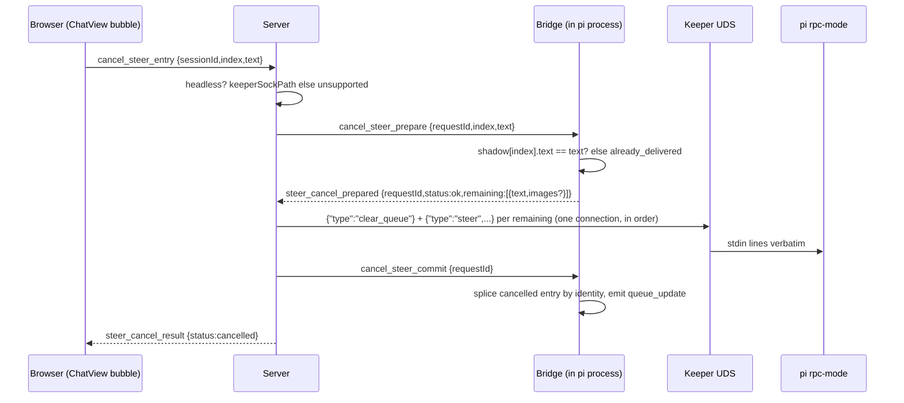

## Context

`queue_update.steering` is `string[]`; many consumers read it as text (`ChatView.tsx:2651`, `live-arrival.ts:124`, `event-wiring.ts:2105`, idle-reaper/quiescence counts via length). Follow-ups already carry `{ text, imageCount }`.

## Decision 1 — steer image count wire shape (chosen: parallel array; confirmed, owner, 2026-11-20)

| Option | Pro | Con |
|---|---|---|
| A. `steering: {text,imageCount}[]` (mirror follow-up) | Structural text↔count association | Breaks every `string` consumer; a stale browser tab calls `steerText.slice` on an object and crashes `ChatView` (follow-up only got `[object Object]`) |
| **B. keep `steering: string[]` + optional `steeringImageCounts: number[]`** | Fully additive both directions; length consumers untouched | Association by index; mitigated by building both arrays from one `SteerEntry[]` snapshot and dropping a misaligned array server-side |

Chosen **B**. The bridge keeps `SteerEntry { text, imageCount, images? }` internally so splice/drain preserve association structurally (same rule as follow-up entries). `images` is only for Decision 3 and never goes on `queue_update`.

## Decision 2 — REST `delivery` default

Server does not default; absent ⇒ omitted ⇒ bridge treats as `followUp`. Matches the existing `send_prompt` pass-through requirement and the WS path. Invalid value ⇒ 400 (REST is an untrusted boundary; WS path stays transparent).

## Decision 3 — #1133 headless-only per-entry steer cancel (confirmed, owner, 2026-11-20)

Owner decision: implement cancel for HEADLESS sessions only (`--mode rpc`, keeper-spawned; `SessionSource` `"dashboard"`, `source-detector.ts:28`) via pi RPC `clear_queue` + re-send. TUI/tmux/zed sessions get no cancel button.

### Verified facts (pi 1.5.0, `node_modules/@earendil-works/pi-coding-agent`)

- `clear_queue` exists: `dist/modes/rpc/rpc-mode.js:331-332` → `session.clearQueue()` (`dist/core/agent-session.js:1962`) empties BOTH `_steeringMessages` and `_followUpMessages` + `agent.clearAllQueues()`, emits `queue_update`, returns `{ steering: string[], followUp: string[] }` — **text only, no images**. Documented at `docs/rpc-commands.md:107` (the `docs/rpc.md` file is only anchors).
- RPC `steer` = `{ type:"steer", message, images?: ImageContent[] }` (`dist/modes/rpc/rpc-types.d.ts:22`) → `session.steer` → `_queueUserInput` (`agent-session.js:1770`): runs extension `input` handlers (`source:"rpc"`), then **expands skill commands + prompt templates** (only for text starting `/`), then queues. The bridge's own path (`pi.sendUserMessage`) uses `expandPromptTemplates:false` (`agent-session.js:1951`). Dashboard `ImageContent` (`validateImages`, `command-handler.ts:1254-1279`) is the same `{type:"image",data,mimeType}` shape.
- rpc-mode starts every stdin line with `void handleInputLine(line)` (`rpc-mode.js:644-645`): the synchronous prefix of each command runs in arrival order; `clearQueue()` is fully synchronous, so it always lands before any later-line `steer` is queued.
- Server → keeper: **no server write client exists** — it was deleted by `retire-slash-dispatch-via-expand-prompt-templates` (`headless-pid-registry.ts:82-87`; `docs` slash-command Path C "RETIRED"). The keeper itself still accepts JSON lines on its UDS/named pipe and forwards each verbatim to pi's stdin (`rpc-keeper/keeper.cjs:246-290`; `sockPathFor`, `keeper-manager.ts:54`). The registry persists `keeperSockPath` per session (`headless-pid-registry.ts:89,571`; `listSessions().hasKeeper`, `:745`).
- Keeper **discards pi's stdout by default** (`keeper.cjs:360-382`, env `PI_KEEPER_CAPTURE_PI_OUTPUT`, `capturePiOutput` opt-in) ⇒ the server cannot read the `clear_queue` response or any `steer` ack.
- Dashboard follow-ups never enter pi's follow-up queue while streaming: they are bridge-buffered (`command-handler.ts:963-967`), so pi's `_followUpMessages` is empty for dashboard-originated work and `clear_queue`'s follow-up wipe loses nothing the dashboard owns.
- The bridge has no `pi.on("input")` handler (grep `packages/extension/src`), so `source:"rpc"` re-sends are not mutated by the bridge.

### Flow (two-phase, server writes to keeper; bridge is the authority for entries and image bytes)

- **Entry + images come from the bridge shadow**, not from `clear_queue`'s response (text only, unreadable). `SteerEntry.images` holds the validated `ImageContent[]` by reference — the same objects pi already holds in its queue — so no extra byte copy; released when the entry is spliced (drain/cancel/reset). Bytes travel bridge→server only inside `steer_cancel_prepared` (localhost WS, bounded by what the user already attached) and are never cached, logged, or put on `queue_update`.
- **Phase 2 commit only after the keeper write succeeded**: a failed write leaves bridge shadow and pi untouched (status `failed`), so the UI never drops a bubble pi will still deliver. Bridge pending-prepare slot expires after 10 s (no commit ⇒ no mutation).
- **Delivery mode**: only steers are re-sent, with `steer`. Pi's follow-up queue is empty for dashboard sessions (above), so "original delivery mode" is satisfied vacuously; dashboard follow-ups stay in the bridge buffer untouched.
- **Order**: remaining entries are written in original order on ONE connection; keeper forwards one connection's lines in order. Server serialises cancels per session (a second cancel while one is in flight ⇒ `busy`) because the keeper does not order writes across connections.
- **Refuse rather than alter**: if any entry to be re-sent starts with `/`, RPC `steer` would expand skill/template text (the bridge path does not) and the queued text would no longer match the shadow ⇒ bridge replies `unresendable`, nothing is mutated. Images dropped by validation are already absent from the entry.
- **Already delivered** (steer drains at every `turn_end`, 1–15 s window): bridge matcher already spliced it, or `shadow[index].text !== text` ⇒ `already_delivered`, no-op, nothing written. Agent not streaming ⇒ shadow empty ⇒ same.
- **Residual race (accepted, documented)**: between the bridge snapshot and the keeper write (a few ms) another entry may drain at `turn_end`; that entry would then be re-queued once more and delivered twice. Pi's `clear_queue` response is the only exact fix and the keeper discards it (and already-running keepers cannot be changed). Window is ms against a 1–15 s cadence; surfaced in the spec, not hidden.
- **Failure modes**: UDS missing/refused/timeout (2 s) ⇒ `failed`, no mutation. Keeper dead ⇒ `unsupported` (no `keeperSockPath`) or `failed`. Server restart mid-flow ⇒ prepare slot expires, no commit.

### Alternatives rejected

| Option | Why not |
|---|---|
| Bridge calls clear itself | `clearQueue` is not on `ExtensionAPI` (`types.d.ts`); spec forbids `pi.clear*Queue` |
| Read `clear_queue` response from keeper | Keeper discards pi stdout by default; changing keeper does not reach already-running keepers |
| Re-send through bridge `send_prompt` | No ordering signal vs stdin `clear_queue` (bridge cannot see pi `queue_update`); would race and could be wiped by the clear |
| Server keeps image bytes | New server-side byte store + eviction; bridge already holds the references |

### Compatibility / rollback

New messages are additive; an old bridge ignores `cancel_steer_prepare` ⇒ server times out (5 s) ⇒ `failed`; an old server never sends it. Button only renders when the parent passes the handler (headless sessions). Rollback = revert; no persisted state.
