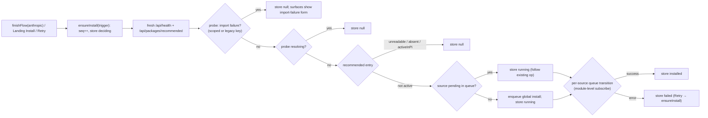

## Context

See proposal.md (Why). The current wiring, with citations:

**Landing Step ②.** The CTA calls `onOpenPinDialog`, which sets `setPinDialogOpen(true)` and mounts `AddFoldersDialog` (`packages/client/src/App.tsx:2733-2747`). Each committed path is pinned by `send({ type: "pin_directory", path })` plus an optimistic `setPinnedDirectories` (`App.tsx:2738-2741`).

**Directory creation.**
- `POST /api/browse/mkdir { parent, name }` calls `createDirectory` (`packages/server/src/browse.ts:232`), which is non-recursive. Errors: 404 when the parent is missing, 409 when the target exists (`packages/server/src/routes/file-routes.ts:378-398`).
- `validateMkdirName` (`browse.ts:208-217`) rejects empty names, surrounding whitespace, `.`/`..`, `/`, `\` and NUL.
- The route sits at tier `control` (`packages/shared/src/route-tiers.ts:249`) and is mirrored as MCP tool `file_mkdir` (`packages/mcp-server-plugin/src/server/tools.manifest.ts:77`).
- Every `/api/*` route must be listed in `ROUTE_TIERS`, and the completeness test fails otherwise (`route-tiers.ts:10-12`).

**Required-extension state.**
- `/api/packages/recommended` returns `activeInPi` per entry. The server computes it with `sourcesMatch` / `nameMatches` across npm, git and local sources (`packages/server/src/routes/recommended-routes.ts:225-241`).
- `MissingRequiredBanner` (`packages/client/src/components/session/MissingRequiredBanner.tsx:24-39`) uses that field to offer Install or Activate for `required` entries. Activate uses the on-disk scope (`:76-80`). The banner is dismissible per session and is mounted **only in the mobile shell** (`packages/client/src/App.tsx:3057`, inside the `isMobile` branch).

**Bridge probe.**
- `useAnthropicPeerProbe` (`packages/client/src/hooks/useAnthropicPeerProbe.ts:46-81`) reads `/api/health`.
- It returns `{ peerMissing: false }` for every non-missing shape: loading, failure, no plugin row, no `lastProbe`, or `ok: true`. It returns `{ peerMissing: true, peerReason }` only for `ok === false`.
- The probe is produced on pi `session_start`, so it is stale between an install and the next session start.

**OAuth completion.**
- `finishFlow(id)` (`packages/client/src/components/settings/ProviderAuthSection.tsx:393-410`) runs once per completed OAuth or device flow, keyed by provider id, and calls `handleChanged()`, which dispatches `provider-auth-event`.
- API-key saves, custom endpoints and model-proxy writes do not pass through `finishFlow`.
- Flow polling is owned by the section, and unmounting the section stops it (`ProviderAuthSection.tsx:420-428`).

**Existing primitives.**
- `packageQueue` is a module singleton with `subscribe`, per-source status, and a 3 s success auto-clear (`packages/client/src/lib/package/package-queue.ts:191`, `:439-449`, `:482`). `enqueue(req, onComplete?(success, error))` silently drops an exact `(source, action)` repeat that is already pending, without calling `onComplete` (`:130-137`).
- E2E: 10 specs click `onboarding-step-2-cta` and expect `AddFoldersDialog` (`tests/e2e/helpers/index.ts:18`).
- `LogBlock` supports `collapsible` and `defaultOpen` (`packages/client/src/components/primitives/LogBlock.tsx:40-51`). It is mandated for log and stderr text by `inline-message-log-primitives`.

## Goals / Non-Goals

**Goals:**
- No manual peer install on the Anthropic subscription path in the common case, including the very first run.
- A first project from one text field and one click. The filesystem browser stays available but is not required.

**Non-Goals:**
- Auto-install on page load, for already-connected rows, or for sign-ins that complete after the settings section has unmounted.
- Server-initiated installs.
- Changing how `peerMissing` is *derived*. Only its rendering yields to the auto-install surface.

## Decisions

### D1: Trigger inside `finishFlow` for `id === "anthropic"`, fire-and-forget
`finishFlow(id)` gets one synchronous line after `handleChanged()`, for `id === "anthropic"` only: `void peerAutoInstall.ensureInstall("sign-in")`. That id is the subscription OAuth flow; `anthropic-api` keys, custom endpoints and model-proxy writes never reach `finishFlow`.

`ensureInstall()` bumps `seq` and sets `deciding` **synchronously, before any await**, then runs detached. It captures its `seq`. A thrown error resets the store to `null` **only if that `seq` is still current**, so dialog close, refresh and dispatch are never affected, and a slow older decision cannot clobber a newer one. `finishFlow` awaits nothing. The Landing **Install** and the **Retry install** on both surfaces call the same `ensureInstall()`. There is one entry point, so the vetoes and the pending rule apply everywhere.

Alternatives considered:
- *A global `provider-auth-event` listener.* Rejected: the event carries no provider id.
- *Server-side, in the auth callback.* Rejected: it puts package policy into the auth server and needs new progress events.

**Gap and its fallback.** A sign-in that completes after the section has unmounted never reaches `finishFlow`, because polling stops on unmount. `MissingRequiredBanner` covers only mobile, so the fallback is the Landing Step ① done row's manual-install state: it appears when `anthropic` is authenticated and `activeInPi === false` (D3c).

### D2: The probe vetoes, `activeInPi` decides, and the install is always global
`ensureInstall()` does two **fresh** reads, `GET /api/health` and `GET /api/packages/recommended`. It never reads the section's `useAnthropicPeerProbe` state: `finishFlow` is a memoised callback captured by the flow poll, so that state would be stale.

The probe body is parsed by a shared `derivePeerState(body)`, extracted from `useAnthropicPeerProbe.ts:derive` so the hook and the decision cannot drift. It checks the scoped key `@blackbelt-technology/pi-anthropic-messages` **and** the legacy key `@pi/anthropic-messages`, and matches `IMPORT_FAILURE_PREFIX` against the trimmed reason.

Rules, first match wins:
1. The peer has an import failure under either key → `null`. The package is present but broken; the surfaces show the import-failure form.
2. The peer is resolving under either key → `null`. This covers resolutions `activeInPi` cannot see: the legacy npm name, tier-1 `node_modules`, a local install in another project.
3. The recommended fetch failed or has no `pi-anthropic-messages` entry → `null` (fail open).
4. `activeInPi === true` → `null`.
5. `packageQueue.isSourcePending(source)` is true → `running`, following that operation. This is a new public, read-only accessor. `enqueue` would silently drop an exact `(source, "install")` repeat without calling `onComplete` (`package-queue.ts:130-137`), so following the existing operation by source avoids a stuck store.
6. Otherwise, `packageQueue.enqueue({ source, action: "install", scope: "global" })` → `running`.

**Scope is always global.** That is the same constant as the hint's install affordance (`ProviderAuthSection.tsx:1000`). The banner's on-disk-scope Activate was rejected because the server resolves local scope from its own cwd (`recommended-routes.ts:353-355`), not from the user's project.

### D3: A module-level store follows the source's queue transitions
`peerAutoInstallStore` (`packages/client/src/lib/package/peer-auto-install-store.ts`) is read through `useSyncExternalStore`.

- **State:** `{ seq, outcome: "deciding" | "running" | "installed" | "failed" | null, message? }`.
- **Watching:** at module load it subscribes once to `packageQueue.subscribe`. While `outcome === "running"` it reads `getStateForSource(source)`: `success` → `installed`, `error` → `failed` (keeping the message). `enqueue` clears the source's sticky success and error (`package-queue.ts:138-139`), so a stale earlier error cannot latch. Following an operation another surface started works the same way. The subscription is module-level, so a success that auto-clears after 3 s while every surface is unmounted is still observed. Another action (`remove`/`update`) on the same source during our run is ignored as negligible.
- **Recovery:** while `outcome === "failed"`, a later `success` for the source moves it to `installed`.
- **Retry:** calls `ensureInstall("retry")`.
- **Reset to `null`, bumping `seq` every time so late transitions are ignored:**
  - a page reload;
  - an App-level effect when `useProvidersReady` reports `anthropic` no longer authenticated. It runs on mount, on focus and on `provider-auth-event`, so it covers in-dashboard sign-out immediately and expiry or CLI logout on the next focus refetch.
- **`installed` clears** when a probe read by a mounted surface reports the peer resolving.

**Accepted:** a sign-out while an install is running discards that success from the store. Landing then relies on `activeInPi`, and the row on the probe, as today.

### D3b: Precedence on the Anthropic row
Order, first match:
1. the probe reports an import failure → the hint's import-failure form;
2. the store has any non-null outcome → the auto-install surface, which also suppresses a stale "not resolving" hint after success;
3. otherwise → the hint exactly as today.

Other surfaces (`MissingRequiredBanner` on mobile, `RecommendedExtensions` in Settings ▸ Packages) are not suppressed:
- their Install on the same source while ours runs is a queue-level no-op shown as `queued`;
- after a failure, their successful Install recovers the store (D3).

This also avoids coupling to the banner's dismissal logic (`MissingRequiredBanner.tsx:50-70`).

### D3c: Landing Step ① done row states
App passes two new props to `LandingPage`: `anthropicAuthenticated`, from an additive field on the `useProvidersReady` result App already holds (`App.tsx:825`), and the store snapshot. `LandingPage` calls `useRecommendedExtensions` **only when `step1 === "done" && anthropicAuthenticated`**, which avoids the cold `/api/packages/recommended` cost for everyone else (`recommended-routes.ts:342-374`). All hooks sit above the legacy early return (`LandingPage.tsx:100-113`).

| First match | Beneath the Step ① label |
|---|---|
| store `deciding` / `running` | in-progress status |
| store `failed` | D7 warning + **Retry install** |
| store `installed` | nothing |
| `anthropicAuthenticated && entry && !entry.activeInPi` | warning "Claude tool calls need pi-anthropic-messages" + **Install** → `ensureInstall("manual")` |
| otherwise | nothing |

If `ensureInstall("manual")` hits the import-failure veto, the store records `outcome: null` with `vetoed: "import-failure"`, and the row shows "pi-anthropic-messages failed to load — see Settings › Providers" with no action.

Peer actions use the ui-contract **secondary** button recipe, so the pending step's CTA stays the only primary.

Both surfaces wrap the status in one persistent `role="status"` / `aria-live="polite"` container, because `InlineMessage` has no live-region semantics.

Test ids: `onboarding-step-1-peer-status`, `onboarding-step-1-peer-install`, `onboarding-step-1-peer-retry`, `anthropic-peer-autoinstall`.

### D4: Server-side create with a realpath containment check and portable names
`createProjectDirectory(name, homeDir)`, where `homeDir = os.homedir()` is read per request (precedent `browse.ts:80`):
1. **Gate.** If `typeof name !== "string"`, return 400 `invalid_name` before any filesystem access.
2. **Validate.** `validateMkdirName(name)`, plus portable rules applied to this endpoint only:
   - no C0 or C1 control characters (U+0000–U+001F, U+007F–U+009F);
   - none of `: * ? " < > |`;
   - no trailing `.` or space;
   - no Windows-reserved basename (`CON`, `PRN`, `AUX`, `NUL`, `CONIN$`, `CONOUT$`, `COM0-9`, `LPT0-9`, superscript `COM¹²³` / `LPT¹²³`), case-insensitive, with or without an extension;
   - at most 255 UTF-8 bytes.

   Failure returns 400 `invalid_name` or `reserved_name`.
3. **Home.** `stat(homeDir)` must be a directory, else 500 `home_missing`. Nothing above `<home>` is ever created.
4. **Root.** `root = join(homeDir, "Projects")`, then a **non-recursive** `mkdir(root)`, tolerating EEXIST. Next, `rootReal = realpath(root)`; `stat(rootReal)` must be a directory, else 409 `root_not_a_directory`. A symlinked root is accepted.
5. **Target.** `target = join(rootReal, name)`. Try a non-recursive `mkdir(target)`:
   - success: `created = true`;
   - EEXIST: `created = false`;
   - ENAMETOOLONG: 400 `too_long`;
   - any other error: 500 `fs_error`.
6. **Containment.** `targetReal = realpath(target)`; ENOENT (a dangling link) → 409 `not_a_directory`. If `targetReal` is neither `rootReal` nor below `rootReal + sep`, return 400 `outside_root`. If `created`, clean up first: `lstat(target)` must still be a directory, then `rmdir`, inside a try/catch that never follows a link.
7. **Type.** If `stat(targetReal)` is not a directory, return 409 `not_a_directory`.
8. **Result.** Return `{ path: targetReal, existed: !created }`. Case and Unicode normalization follow the OS: a case-insensitive filesystem may reuse `Demo` for `demo`.

This narrows, but cannot eliminate, races against a local attacker who can swap entries inside `~/Projects`. Such an attacker already controls the user's home directory.

Gates:
- `networkGuard`;
- `ROUTE_TIERS` row `{ POST /api/browse/create-project, tier: "control" }`;
- MCP: a `tools.denylist.ts` entry ("UI-only first-run convenience; agents use `file_mkdir`"), plus a test asserting no `create-project` tool is generated.

Shared types: `CreateProjectRequest` / `CreateProjectResult` / `CreateProjectErrorReason` in `packages/shared/src/rest-api.ts`, next to `MkdirRequest` (`:349`).

Log: `[create-project] <created|reused|rejected:<reason>> name=<JSON.stringify(name.slice(0, 64))> bytes=<n>`.

`/api/browse/mkdir` is untouched.

### D5: Landing Step ② form
- **Pending body.** Field label "Project name". The input is prefilled with `my-first-project`. The hint reads "Creates a folder with this name in your Projects folder", which avoids a hard-coded path; the real absolute path appears in the done row.
- **Controls.** The primary **Create project** gets the new `data-testid="onboarding-step-2-create"`. The secondary link **Use an existing folder…** keeps `onboarding-step-2-cta` and its meaning (it opens `AddFoldersDialog`), so every E2E spec that uses it through `tests/e2e/helpers/index.ts:18` is unaffected. The harness seeds credentials, so Step ② is never locked there.
- **Validation.** Only the server validates. Its `reason` maps to localized guidance, for example `invalid_name` → "Use a single folder name without / or \\, for example my-project." An unknown reason, or a non-ApiResponse body such as an older server's Fastify 404, maps to a generic message. The message renders between the label and the input, with `aria-invalid` and `aria-describedby`, and the input keeps the user's text.
- **In flight.** The field, the button and the link are disabled; the button gets `aria-busy` and reads "Creating…".
- **Success.** Optimistic `setPinnedDirectories` (already de-duplicated by `includes`) plus `send({ type: "pin_directory", path })`, the same path as `AddFoldersDialog.onPin`. The done row shows the pinned-folder count; when `existed`, it adds one line, "That folder already existed, so it was pinned as-is."
- **Test ids:** `onboarding-step-2-create`, `onboarding-step-2-cta` (existing-folder link), `onboarding-step-2-name`, `onboarding-step-2-error`, `onboarding-step-2-existed`, `onboarding-progress`.

### D6: Landing becomes a vertical stepper
One card-root `<ol>` (`ui-contract.md`, card root recipe):
- The active step is expanded, with exactly one `--accent-solid` primary button.
- Done steps are one line with a check marker.
- Locked steps are one line with a lock marker and a "Needs …" reason.
- A "n of 3 done" line plus a bar sits above the list.
- The existing `onboarding-step-N-cta` and `onboarding-step-N-done` testids are preserved.

Locked rows render **no controls**, only the lock marker and "Needs …" text. The unit tests that assert disabled locked CTAs (`LandingPage.test.tsx:69-70,92-93`) change to assert the lock text instead. E2E is unaffected because the harness seeds credentials.

Copy keeps the spec's done-row labels: "Credentials configured", the pinned-folder count, the active-session count. Step titles are "Connect a model provider", "Create your first project" and "Start your first session". Mockup: `mockups/index.html`; rationale with public-rule citations: `mockups/ui-plan.md`.

Alternatives considered:
- *Three cards with card 2 widened.* Rejected: broken alignment.
- *A modal for creating the project.* Rejected (NN/g modal guidance): the user is not interrupting another task.

### D7: Failure copy puts the plain sentence first, with raw output in a `LogBlock`
On both surfaces the failure is an `InlineMessage` with `severity="warning"`, because sign-in succeeded and the problem is recoverable. It contains:
- Title: "Couldn't install pi-anthropic-messages".
- Body: "The install didn't finish. Try again; if it keeps failing, check your network or proxy. Chat with Claude works; tool calls need this package." This is generic on purpose: the failure may be network, a busy queue (409), a tier rejection, npm E404 or EACCES, and the raw text is in the log block.
- A **Retry install** button, using the secondary-button recipe.
- `<LogBlock collapsible defaultOpen={false} label="Details" text={message} />`, as `inline-message-log-primitives` mandates. It provides copy and bounded height, and needs no new token.

## Risks / Trade-offs

- **[Install without a click]** A package install runs on a sign-in event. → The source is a module constant equal to the `RECOMMENDED_EXTENSIONS` entry. The scope is always global, the same as the hint. Nothing is taken from a response.
- **[Slow decision]** On a cold cache, `/api/packages/recommended` can take seconds (`recommended-routes.ts:342-374`). → The `deciding` state renders as in-progress immediately.
- **[Offline or corporate proxy]** → A plain-language warning plus Retry. Sign-in is never blocked.
- **[Sign-in completes after settings unmounts]** (D1 gap) → No automatic install, but the Landing Step ① manual-install state (D3c) appears on every platform.
- **[Stale recommended cache]** `/api/packages/recommended` can serve a 60 s-old `activeInPi` after an install. → Landing renders nothing for store `installed`, so it never offers Install over a fresh success. A pre-existing cache race in `recommended-routes.ts` is out of scope.
- **[Page reload resets the store]** → After a reload the row hint is probe-driven as today, and Landing D3c still offers Install while `activeInPi === false`. `activeInPi` prevents redundant installs.
- **[Optimistic pin can be dropped]** (WS down or missing scope) → Same as `AddFoldersDialog` today. The `pinned_dirs_updated` echo reconciles it.
- **[`~/Projects` inside Docker is ephemeral]** → "Use an existing folder…" covers `PI_WORKSPACES` mounts. No harness or E2E variant change is needed: the auto-install path needs a real OAuth completion, which the harness does not drive (`unverified` beyond the spec titles in `flow-plugin-e2e`).
- **[Containment root vs `file-read-containment`]** → Unrelated anchors. That capability governs file reads relative to a session cwd; this endpoint creates directories under a fixed home root.
- **[Adopted `extensions-hub` mockup has no tasks]** → Kept at the user's request, and labelled reference-only.

## Migration Plan

Additive, and client and server ship together. If a client from this change talks to an older server, the create endpoint returns Fastify's 404 envelope: the form maps it to the generic message, and the secondary action still works. Rollback is a revert; created folders and installed packages remain.
