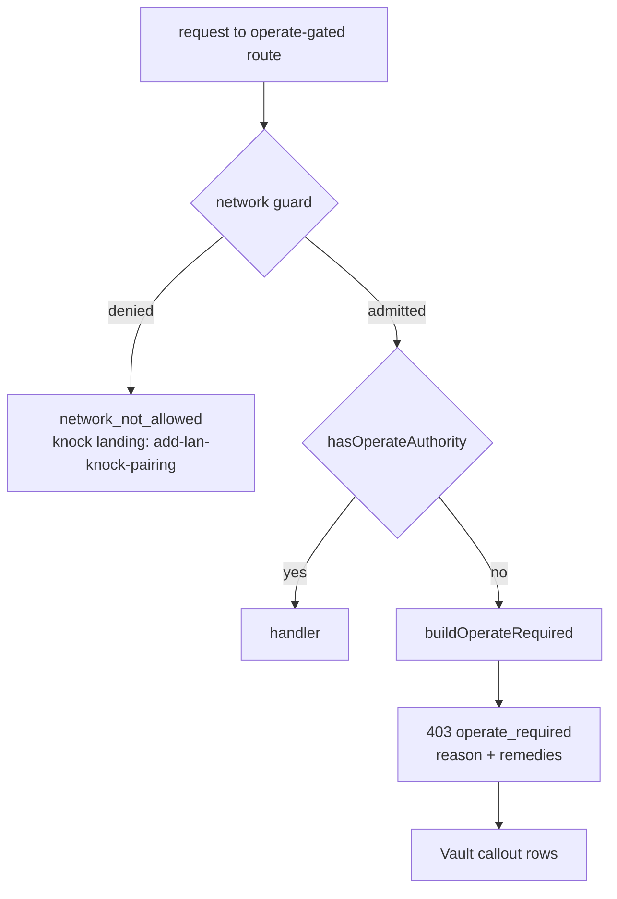

## Context

Two routes gate on `operate` authority with byte-identical private predicates:
`canManageVault` (`packages/server/src/vault/vault-routes.ts`) and
`canMutateServices` (`packages/server/src/services/routes.ts`). Both accept a
paired-device bearer whose `principalTier` is `operate`, an `authVia` of
`session`/`principal`, or `isLocallyTrusted` (strict-mode aware), and refuse with
`{success:false, error:"operate_required", message}`.

Diagnosed 2026-10-13 with a names-only server log line on the vault refusal:
`ip=192.168.16.220 authVia=- isAuth=false strict=false fwd=[]` — a LAN browser
admitted by `auth.bypassHosts`, carrying no credential. Plain-http LAN browsers
cannot pair today (QR payload is TLS-only); `add-lan-knock-pairing` will add the
knock flow, but only on network denial.

## Goals / Non-Goals

Goals: name the cause and the way out, as data, without changing who is admitted.
Non-goals: loosening the gate; pairing or knock changes; a Services web UI.

## Decisions

### D1 — One shared module for the predicate and the refusal

`packages/server/src/auth/operate-required.ts` exports `hasOperateAuthority(request,
localTrust?)` (the existing predicate, moved verbatim) and
`sendOperateRequired(request, reply, deps)`. Both routes import it. The predicate
is already duplicated at two sites and the refusal must match across them, so a
shared helper is justified. Alternative — add remedies in each route — rejected:
two copies of the disclosure rule drift.

### D2 — `reason` comes from the auth markers already on the request

`authVia === "device"` and `principalTier !== "operate"` → `tier-too-low`; anything
else that reaches the refusal → `no-credential`. `session`/`principal` callers
never reach the refusal (the predicate admits them), so no third reason exists.

### D3 — Remedy availability is injected, not discovered

`sendOperateRequired` takes `deps: { loginAvailable(): boolean;
knockAvailableFor?(request): boolean }`. `loginAvailable` reads the same auth
state the login page renders its methods from (OAuth provider with a non-empty
`clientId`, or passkeys enabled) — the implementer locates that accessor in
`auth/auth-plugin.ts` rather than re-deriving it. `knockAvailableFor` is absent
until `add-lan-knock-pairing` provides it; absent → no `request-access`. This
keeps this change independent of the knock change and of its admission gates.

### D4 — Disclosure is limited to what the caller can already learn

The caller knows whether it sent a credential and its own tier; the login page and
the knock route are public. Nothing else is disclosed (see spec: no host names,
addresses, ranges, device labels, access-grant posture). `message` is a fixed
string per route and `reason` (today's route messages are kept for
`no-credential`), never interpolated. This keeps the body outside
`canDiscloseAccessPosture`, which a trusted-network caller without a credential
fails.

### D5 — Client: typed result, callout only for `operate_required`

`lib/vault/vault-api.ts` `VaultResult` gains `code?: string` and
`remedies?: OperateRemedy[]` (from `@…/shared` types). `VaultSection` branches on
`code === "operate_required"` → `OperateRequiredCallout`; missing `remedies`
(older server) → `["use-host"]`. The `use-host` row text uses no server-supplied
host; it says "Open the dashboard on the computer that runs it". `request-access`
renders a button whose action is supplied by `add-lan-knock-pairing`; until then
the row never renders because the server never sends it.

## Risks / Trade-offs

- A remote attacker learns whether a login method is configured → already visible
  on the public login page. Accepted.
- `use-host` is unhelpful for a headless server → it is still true, and `sign-in`
  / `request-access` appear when configured. Accepted.

## Migration Plan

None. Additive body fields; status, `error`, `message` and admission unchanged.
Rollback: revert.
