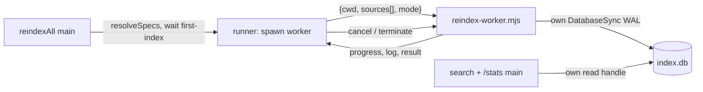

## Context

#1131 asks for 8 fixes; acceptance criteria are (a) non-row kb edits force no reindex, (b) event-loop lag < ~200 ms during a forced ~50k-chunk reindex, (c) one forced rebuild per DB at a time. This change delivers (a) and (b) (time-bounded batches + a kb worker thread); (c) is deferred.

## Decisions

### D1 — Fingerprint narrowing: allowlist hash + closure guard test (confirmed (owner, 2026-11-20))
Options: (A) hash an allowlist of row-producing files; (B) hand-bumped `INDEX_FORMAT_VERSION`; (C) hash all of `src/` minus an exclude-list.
Chosen **A + guard test**: content-derived (no human to forget a bump; chunker edits always invalidate), false positives limited to 5 files. Guard test asserts the `indexer.ts` import closure ⊆ allowlist ∪ explicit non-row list, so a new row-producing import fails CI. `sqlite-store.ts` is excluded from the hash (it also holds search code, which `bound-kb-proximity-search` already edited) and stays governed by the existing hand-bumped `SCHEMA_VERSION` (`sqlite-store.ts:12`, `index-gate.ts:40`). Risk: a row-affecting write-path edit in `sqlite-store.ts` (FTS5 DDL, tokenizer, column set, `insert*`) without a `SCHEMA_VERSION` bump ⇒ stale rows. Mitigated mechanically: a golden test pins `{SCHEMA_VERSION, sha256(DDL constant)}` and fails with "bump SCHEMA_VERSION" when the DDL changes without a bump (insert-path edits that leave the DDL unchanged remain review-governed — accepted limitation). (B) rejected: relies on discipline, exactly what the engine hash replaced. (C) rejected: new files default into the hash ⇒ same storm.

### D2 — Time budget in the batch loop
Add `INDEX_BATCH_MAX_MS = 50` beside `YIELD_EVERY` (`indexer.ts:68`); the loop condition becomes `sinceYield >= YIELD_EVERY || performance.now() - lastYield >= INDEX_BATCH_MAX_MS`. Reuses the idiom of `WALK_YIELD_MAX_MS`. Cost: more commits (WAL) ⇒ measured in task 1.x; if throughput drops > 15 % raise the budget. One file's chunk+write remains the minimum unit.

### D3 — kb-specific worker_threads reindex worker (CHANGED; confirmed (owner, 2026-11-20))
Options considered: (A) kb-specific worker now; (B) wait for #417's generic pool; (C) defer. Owner chose **A**: #417 stays open and untouched; this worker is self-contained and can adopt the pool later. D2 stays: it bounds cancel latency, WAL commit size, and still serves the in-process callers (kb-extension, CLI).

**Verified facts (code, 2026-11-20)**
- Single seam: every server reindex goes through `reindexAll` (`kb-routes.ts:302`) via `registry.start(cwd, fn)` (`kb-routes.ts:519,700`, `index.ts:72`); `indexInPlace` (`kb-routes.ts:264`) and `firstIndex` (`:242`, `runIndexAtomic`) do the heavy work and are `await`ed on the main loop.
- Driver: `node:sqlite` `DatabaseSync` (`sqlite-store.ts:7`), not better-sqlite3. Spike on Node 24.15 (this session): a `worker_threads` worker opened its own `DatabaseSync`, set `journal_mode=WAL`, wrote; the main thread's separate handle read the committed row. Works; every thread needs its own handle (handles are not transferable).
- Concurrency settings already in the store: `journal_mode=WAL` (`sqlite-store.ts:126`), `busy_timeout` default 5000 ms (`:130`, `setBusyTimeout` `:199`). WAL ⇒ main-thread readers (search, `/stats`) never block on the worker's writes; a reader only hits `SQLITE_BUSY` on writer contention, which the 5 s timeout would make a *synchronous* main-thread wait ⇒ the main thread must not write to a DB while its worker runs (stamps move into the worker; audit task 4.6). The main read handle keeps its default `busy_timeout`: lowering it would turn contention into thrown `SQLITE_BUSY` errors for search/stats rather than a consistent snapshot, so it is deliberately NOT lowered; with no main-thread writer, WAL readers do not hit it.
- Job reporting today: `KbJobRegistry` (`job-registry.ts`): per-cwd `start(cwd, fn)`, coalescing, `statusFor/isRunning/jobId`, `JobState{status,startedAt,finishedAt,changed,chunks,error,outcomes}`. **No cancel, no progress.** `IndexOptions` has `heartbeat`/`onFirstBatch` hooks only (`indexer.ts:35,39`); `runIndexAtomic` overrides `heartbeat` (`index-run.ts:351,397`), so cancel/progress get their own additive options.
- Server loads TS via the native `--import` loader (`packages/server/bin/pi-dashboard.mjs`, `shared/src/platform/native-ts-register.mjs`); precedent for a plain-`.mjs` worker with an injectable `workerFactory`: `packages/server/src/auth/credential-key.ts:56,260`.
- **Shipped precedent for a kb worker (#1177, `883d8af23`):** `packages/kb-extension/src/query-worker-host.ts` (lazy single worker, `ready`/`load-failed` handshake, abort/deadline → `terminate()`, crash cap → in-process fallback, kill switch `KB_QUERY_WORKER=0`), `query-worker.mjs` (plain-`.mjs` bootstrap) and `query-worker-entry.ts` (op dispatcher importing `@blackbelt-technology/pi-dashboard-kb`), with `__tests__/query-worker-loader.test.ts` proving real-worker loading (dev layout, under the native TS loader, and a published `node_modules` layout). It spawns `new Worker(url, { execArgv: [], resourceLimits, workerData })` and installs **per-thread** `module.registerHooks` (resolve: `.js`→`.ts` retry on not-found for relative/`file:` specifiers; load: `stripTypeScriptTypes` strip mode, also under `node_modules`), following `packages/shared/src/platform/native-ts-hooks.mjs`; expected `ExperimentalWarning`s are silenced in-thread. This change adopts the same host/lifecycle/kill-switch/fallback shape and the same loader approach for the reindex worker.

**Design**

- `reindex-core.ts` (kb-plugin): `indexInPlace`/`firstIndex` bodies moved verbatim (store open, `sourceGateIsStale`, `beginForcedSource`, `stampSource`, `stampPass`, `runIndexAtomic`) taking plain data: `{cwd, sources:[{ref,kind,id,dir,revision?}], mode:'in-place'|'first', gate}` (`gate` = the main-side gate value string for the config it resolved the sources from); returns `{changed, chunks, outcomes}` (structured-cloneable). Called by the worker, and in-process when the kill-switch is set — one implementation, two hosts. The bodies move verbatim **except** abort handling: today's per-source `try/catch` in `indexInPlace` (`kb-routes.ts:277`) and the `catch` in `firstIndex` (`:242-262`) convert any throw into an `error` outcome, which would swallow `KbIndexAborted`, start the next source and still run `stampPass`. The core therefore rethrows when `signal.aborted`/`KbIndexAborted` **before** recording an outcome, and skips `stampSource`/`stampPass` on abort.
- `reindex-worker.mjs`: plain `.mjs`, `loadConfig(cwd)` itself (no function/object config crosses the boundary) and compares its gate value with the `gate` passed by main — on mismatch (config edited between main's resolve and the worker's load) the job fails with "config changed during reindex" instead of indexing config A's sources under config B's gate — runs core, `postMessage` coalesced progress (≥250 ms) / log lines / final result. Owns its `SqliteFtsStore` (in-place) or the temp-file builder (first index) — the main thread opens no write handle.
- `reindex-runner.ts`: `new Worker(entry, {workerData})` (host shape follows `query-worker-host.ts`) (injectable `workerFactory`, like `credential-key.ts`); maps `message`→progress/log, `error`/non-zero `exit`→rejected job (server survives a worker crash/OOM); `abort` signal→`postMessage({cancel})`, then `terminate()` after a 5 s grace (immediately on server shutdown/`onClose`). After any non-graceful worker exit (terminate, crash, OOM) in `first` mode the runner unlinks `<db>.tmp-${process.pid}` and its `-wal`/`-shm` sidecars: a worker shares the server's PID, so `sweepOrphanTemps` (skips own PID) and `isFirstIndexLive` (skips own PID) never reclaim it, and the next first index would reopen the half-built file.
- **One worker per KB at a time**: `registry.start` already coalesces per cwd; the runner asserts no live worker for the cwd.
- **Cancellation:** additive `IndexOptions.signal?: AbortSignal`, checked per file next to `heartbeat` and at each batch boundary (`indexer.ts:192-199`); throws `KbIndexAborted`, which rolls back the open batch (existing rollback scenario). Worker aborts its own `AbortController` on the `cancel` message — handled at the next yield (≤ `INDEX_BATCH_MAX_MS` + one file). In-place: committed batches stay (idempotent re-run), later sources untouched, no stamps. First index: graceful abort ⇒ the `finally` `closeAndUnlink`s the temp; terminate/crash ⇒ runner unlink (above). `reindexAll` accepts the registry's `AbortSignal` (`opts.signal`): it is checked before/after `resolveSpecs` and the first-index wait loop (`kb-routes.ts:309`) races the signal, so a cancel arriving while waiting on another process's first index settles at once. Registry settles a cancelled job **restoring the pre-start job state**: a cancelled run is neither a success nor a failure, so no new error is recorded and a previously retained failure (main spec "until a later success clears it") stays. Cancel→reindex race: while a job is `cancelling` (grace period), `registry.start` for that cwd waits for it to settle and then starts a fresh job (rather than coalescing onto the dying one and being silently dropped); same for the config-save chained reindex. `terminate()` mid-transaction is safe: SQLite recovers the uncommitted WAL frames. Cancel sources: `POST /api/kb/reindex/cancel`, folder vanished (`folderExists`), Fastify `onClose` (server shutdown).
- **Progress:** additive `IndexOptions.onProgress?({root,done,total})` at each batch commit; registry stores last progress; `GET /api/kb/stats` returns optional `progress` while running. Existing fields unchanged.
- **Loader (task 4.1; precedent `query-worker.mjs`):** the worker imports `@blackbelt-technology/pi-dashboard-kb` (`exports` → `src/index.ts`) and `reindex-core.ts`. Default: do NOT rely on `process.execArgv` inheritance; reuse the shipped approach — `new Worker(url, { execArgv: [], … })` plus the plain-`.mjs` bootstrap registering per-thread `module.registerHooks` (`.js`→`.ts` resolve retry, strip-mode `.ts` load), which is proven for dev, the native-loader process (no hook stacking, test W25) and the published `node_modules` layout (W23). Open sub-question for 4.1: import the hooks from `packages/shared/src/platform/native-ts-hooks.mjs` (server depends on shared) or copy the ~25-line bootstrap as kb-extension does (it has no shared dependency); verify in `--dev`, production and Electron-packaged. Only if the shipped approach fails in a layout, fall back to explicit `execArgv: ['--import', <native-ts-register.mjs>]`. Do NOT fall back to `packages/kb/dist` (gitignored, can be stale vs the source engine fingerprint).
- **Kill-switch:** `PI_DASHBOARD_KB_REINDEX_WORKER=0` ⇒ in-process path (same core). Used by tests that mock fs and as instant rollback.
- **Observability:** per job one structured log line — `mode=worker|inprocess`, sources, files, chunks, wall ms, worker spawn→first-progress ms, main-thread max event-loop delay (`perf_hooks.monitorEventLoopDelay`), outcome (`ok|error|cancelled|crashed`); logs for worker start/exit code/terminate; worker log messages forwarded with the existing `[kb-plugin]` prefix.

**Measurement-first / budget:** target **no main-thread event-loop lag > 200 ms during a full reindex of a ~50k-chunk KB** (worker mode). Tasks 1.x take the baseline (in-process, current code); 3.x measure in-process with the time budget; 4.x measure worker mode. Throughput guard: worker-mode wall time ≤ 115 % of the current in-process baseline. In-process, the spec/test assert the deterministic property (commit+yield cadence ≤ budget + one file); measured lag stays a non-gating `KB_MEASURE` report. Estimated remaining main-thread work in worker mode: spawn + message handling (µs–ms); the residual risk is `resolveSpecs` (git/remote resolution) staying on main.

**Trade-offs:** +~3 files and a loader dependency; worker cold start (~50–100 ms) and a second copy of the kb modules in memory; structured-clone of small progress objects only. Rejected: running the worker via `child_process` (heavier IPC/ lifecycle, no gain over shared-nothing threads); sharing the main thread's DB handle (not transferable, defeats isolation).

## Measurements

_To be recorded by tasks 1.2 (baseline), 3.4 (time budget, in-process) and 4.9 (worker mode): max/p99 event-loop delay, wall ms, commit count, chunks, files._

## Risks / Trade-offs

- Narrow hash ⇒ a missed row-producing change leaves stale rows until `SCHEMA_VERSION`/options bump or file edit → guard test + review.
- One-time forced rebuild on upgrade (migration above).
- Time budget cannot split one pathological file or the post-walk single-statement sweeps (in worker mode these no longer block the server loop).
- Worker TS loading may differ across dev/prod/Electron ⇒ reuse the shipped `query-worker.mjs` hooks approach, confirm in spike 4.1 + kill-switch.
- Second writer process (kb-extension in a pi session) can still contend for the DB: now surfaces as a worker-side `SQLITE_BUSY` job error after 5 s instead of a server stall (one-writer lease stays deferred).
- Terminate/crash during a first-index leaves `<db>.tmp-<serverPid>` (worker shares the PID) ⇒ runner unlinks it; integration test 4.4 terminates a real worker mid first-index and asserts the temp is gone without a server restart.
- Mixed versions: old kb-extension sessions ping-pong the engine record with the new server until reloaded (see proposal Compat) — documented, no engineering.
- Packaging: worker entry + the TS-loading bootstrap must hold in the packaged Electron layout ⇒ task 4.10 bundle assert; kill-switch stays default-on only if it passes.
