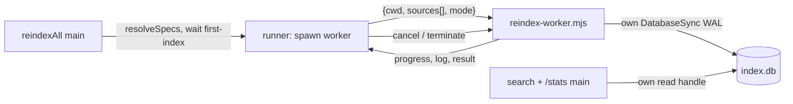

## Context

#1131 asks for 8 fixes; acceptance criteria are (a) non-row kb edits force no reindex, (b) event-loop lag < ~200 ms during a forced ~50k-chunk reindex, (c) one forced rebuild per DB at a time. This change delivers (a) and (b) (time-bounded batches + a kb worker thread); (c) is deferred.

## Decisions

### D1 — Fingerprint narrowing: allowlist hash + closure guard test (confirmed (owner, 2026-11-20))
Options: (A) hash an allowlist of row-producing files; (B) hand-bumped `INDEX_FORMAT_VERSION`; (C) hash all of `src/` minus an exclude-list.
Chosen **A + guard test**: content-derived (no human to forget a bump; chunker edits always invalidate), false positives limited to 5 files. Guard test asserts the `indexer.ts` import closure ⊆ allowlist ∪ explicit non-row list, so a new row-producing import fails CI. `sqlite-store.ts` is excluded from the hash (it also holds search code; `bound-kb-proximity-search` edits it) and stays governed by the existing hand-bumped `SCHEMA_VERSION` (`sqlite-store.ts:12`, `index-gate.ts:40`). Risk: a row-affecting write-path edit in `sqlite-store.ts` without a `SCHEMA_VERSION` bump ⇒ stale rows; mitigated by the guard test comment + review. (B) rejected: relies on discipline, exactly what the engine hash replaced. (C) rejected: new files default into the hash ⇒ same storm.

### D2 — Time budget in the batch loop
Add `INDEX_BATCH_MAX_MS = 50` beside `YIELD_EVERY` (`indexer.ts:68`); the loop condition becomes `sinceYield >= YIELD_EVERY || performance.now() - lastYield >= INDEX_BATCH_MAX_MS`. Reuses the idiom of `WALK_YIELD_MAX_MS`. Cost: more commits (WAL) ⇒ measured in task 1.x; if throughput drops > 15 % raise the budget. One file's chunk+write remains the minimum unit.

### D3 — kb-specific worker_threads reindex worker (CHANGED; confirmed (owner, 2026-11-20))
Options considered: (A) kb-specific worker now; (B) wait for #417's generic pool; (C) defer. Owner chose **A**: #417 stays open and untouched; this worker is self-contained and can adopt the pool later. D2 stays: it bounds cancel latency, WAL commit size, and still serves the in-process callers (kb-extension, CLI).

**Verified facts (code, 2026-11-20)**
- Single seam: every server reindex goes through `reindexAll` (`kb-routes.ts:302`) via `registry.start(cwd, fn)` (`kb-routes.ts:519,700`, `index.ts:72`); `indexInPlace` (`kb-routes.ts:264`) and `firstIndex` (`:242`, `runIndexAtomic`) do the heavy work and are `await`ed on the main loop.
- Driver: `node:sqlite` `DatabaseSync` (`sqlite-store.ts:7`), not better-sqlite3. Spike on Node 24.15 (this session): a `worker_threads` worker opened its own `DatabaseSync`, set `journal_mode=WAL`, wrote; the main thread's separate handle read the committed row. Works; every thread needs its own handle (handles are not transferable).
- Concurrency settings already in the store: `journal_mode=WAL` (`sqlite-store.ts:122`), `busy_timeout` default 5000 ms (`:126`, `setBusyTimeout` `:196`). WAL ⇒ main-thread readers (search, `/stats`) never block on the worker's writes; a reader only hits `SQLITE_BUSY` on writer contention, which the 5 s timeout would make a *synchronous* main-thread wait ⇒ the main thread must not write to a DB while its worker runs (stamps move into the worker; audit task 5.6).
- Job reporting today: `KbJobRegistry` (`job-registry.ts`): per-cwd `start(cwd, fn)`, coalescing, `statusFor/isRunning/jobId`, `JobState{status,startedAt,finishedAt,changed,chunks,error,outcomes}`. **No cancel, no progress.** `IndexOptions` has `heartbeat`/`onFirstBatch` hooks only (`indexer.ts:35,39`); `runIndexAtomic` overrides `heartbeat` (`index-run.ts:351,397`), so cancel/progress get their own additive options.
- Server loads TS via the native `--import` loader (`packages/server/bin/pi-dashboard.mjs`, `shared/src/platform/native-ts-register.mjs`); precedent for a plain-`.mjs` worker with an injectable `workerFactory`: `packages/server/src/auth/credential-key.ts:56,260`.

**Design**

- `reindex-core.ts` (kb-plugin): `indexInPlace`/`firstIndex` bodies moved verbatim (store open, `sourceGateIsStale`, `beginForcedSource`, `stampSource`, `stampPass`, `runIndexAtomic`) taking plain data: `{cwd, sources:[{ref,kind,id,dir,revision?}], mode:'in-place'|'first'}`; returns `{changed, chunks, outcomes}` (structured-cloneable). Called by the worker, and in-process when the kill-switch is set — one implementation, two hosts.
- `reindex-worker.mjs`: plain `.mjs`, `loadConfig(cwd)` itself (no function/object config crosses the boundary), runs core, `postMessage` coalesced progress (≥250 ms) / log lines / final result. Owns its `SqliteFtsStore` (in-place) or the temp-file builder (first index) — the main thread opens no write handle.
- `reindex-runner.ts`: `new Worker(entry, {workerData})` (injectable `workerFactory`, like `credential-key.ts`); maps `message`→progress/log, `error`/non-zero `exit`→rejected job (server survives a worker crash/OOM); `abort` signal→`postMessage({cancel})`, then `terminate()` after a 5 s grace.
- **One worker per KB at a time**: `registry.start` already coalesces per cwd; the runner asserts no live worker for the cwd.
- **Cancellation:** additive `IndexOptions.signal?: AbortSignal`, checked per file next to `heartbeat` and at each batch boundary (`indexer.ts:192-199`); throws `KbIndexAborted`, which rolls back the open batch (existing rollback scenario). Worker aborts its own `AbortController` on the `cancel` message — handled at the next yield (≤ `INDEX_BATCH_MAX_MS` + one file). In-place: committed batches stay (idempotent re-run). First index: temp build discarded, swept by `sweepOrphanTemps`. Registry settles a cancelled job as idle with no `lastError`. `terminate()` mid-transaction is safe: SQLite recovers the uncommitted WAL frames. Cancel sources: `POST /api/kb/reindex/cancel`, folder vanished (`folderExists`), Fastify `onClose` (server shutdown).
- **Progress:** additive `IndexOptions.onProgress?({root,done,total})` at each batch commit; registry stores last progress; `GET /api/kb/stats` returns optional `progress` while running. Existing fields unchanged.
- **Loader risk (task 5.1 spike):** the worker imports `@blackbelt-technology/pi-dashboard-kb` (`exports` → `src/index.ts`). Worker threads inherit `process.execArgv` (`--import` native TS loader) by default; verify in dev (`--dev`), production and the Electron-packaged runtime. If not inherited, pass `execArgv: ['--import', <native-ts-register.mjs>]` explicitly. Do NOT fall back to `packages/kb/dist` (gitignored, can be stale vs the source engine fingerprint).
- **Kill-switch:** `PI_DASHBOARD_KB_REINDEX_WORKER=0` ⇒ in-process path (same core). Used by tests that mock fs and as instant rollback.
- **Observability:** per job one structured log line — `mode=worker|inprocess`, sources, files, chunks, wall ms, worker spawn→first-progress ms, main-thread max event-loop delay (`perf_hooks.monitorEventLoopDelay`), outcome (`ok|error|cancelled|crashed`); logs for worker start/exit code/terminate; worker log messages forwarded with the existing `[kb-plugin]` prefix.

**Measurement-first / budget:** target **no main-thread event-loop lag > 200 ms during a full reindex of a ~50k-chunk KB** (worker mode). Tasks 1.x take the baseline (in-process, current code); 3.x measure in-process with the time budget; 5.x measure worker mode. Throughput guard: worker-mode wall time ≤ 115 % of the current in-process baseline. Estimated remaining main-thread work in worker mode: spawn + message handling (µs–ms); the residual risk is `resolveSpecs` (git/remote resolution) staying on main.

**Trade-offs:** +~3 files and a loader dependency; worker cold start (~50–100 ms) and a second copy of the kb modules in memory; structured-clone of small progress objects only. Rejected: running the worker via `child_process` (heavier IPC/ lifecycle, no gain over shared-nothing threads); sharing the main thread's DB handle (not transferable, defeats isolation).

## Measurements

_To be recorded by tasks 1.2 (baseline), 3.4 (time budget, in-process) and 5.7 (worker mode): max/p99 event-loop delay, wall ms, commit count, chunks, files._

## Risks / Trade-offs

- Narrow hash ⇒ a missed row-producing change leaves stale rows until `SCHEMA_VERSION`/options bump or file edit → guard test + review.
- One-time forced rebuild on upgrade (migration above).
- Time budget cannot split one pathological file or the post-walk single-statement sweeps (in worker mode these no longer block the server loop).
- Worker loader inheritance may differ across dev/prod/Electron ⇒ spike 5.1 + kill-switch.
- Second writer process (kb-extension in a pi session) can still contend for the DB: now surfaces as a worker-side `SQLITE_BUSY` job error after 5 s instead of a server stall (one-writer lease stays deferred).
- Terminate-on-timeout during a first-index leaves a temp file ⇒ relies on `sweepOrphanTemps`; covered by test 5.4.
