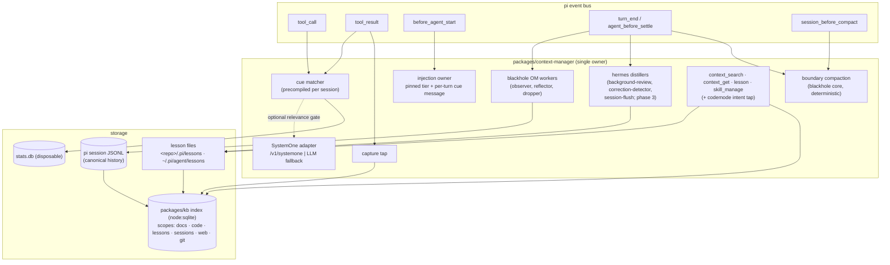

# Design: unify-context-manager

## Context

See `proposal.md` (Why) and `docs/research/unified-context-manager-exploration.md`
for the measurements referenced below.

State today (pi 1.3.0, this host; re-checked 2026-10-21, first written on 0.87.1):

| Plane | License | LOC | Engine | Hooks it owns |
|---|---|---:|---|---|
| pi-hermes-memory 0.9.10 | MIT | ~17.8k | better-sqlite3 | before_agent_start, message_end, session_before_compact, turn_end, tool_result, resources_discover |
| pi-blackhole 0.5.15 | MIT | ~38.7k (`pi-base` 8.4k) | JSONL `custom` entries | context, session_before_compact, turn_end, agent_start/end, `AgentSession.compact` monkeypatch (`src/om/inline-compaction.ts`) |
| context-mode 1.0.169 | Elastic-2.0 | compiled only | better-sqlite3 + MCP child | tool_call, tool_result, before_agent_start, context, session_before_compact, turn_end, before_provider_response |
| kb + kb-extension | ours | ~8.1k | node:sqlite | before_agent_start, tool_call, tool_result, turn_start |
| pi built-ins (0.99+) | pi | — | QuickJS | `codemode`, `tool_search`, MCP client |

Upstream changes consumed since the first draft:
- hermes 0.9.10: per-entry recall counters (`hit_count`, `last_hit_at`,
  bumped on every `memory_search` return) and `consolidationUsageSignals`;
  chunked consolidation. Used by `import-hermes` (D10).
- blackhole 0.5.7–0.5.15: observation/reflection `supersedes`, reflection
  evidence timestamps, `[User Decisions]` from question tools,
  `/blackhole-export mode:timeline days:N` plus headless `--blackhole-export`.
  Pi 1.x support still goes through the `AgentSession.compact` patch, so D3
  stands.
- pi-web-access 0.42–0.44: `toolExposure: "deferred"` and
  `toolActivation: "none"` (web tools reachable only via `codemode` /
  `tool_search`). D8 must therefore see nested calls.
- `add-kb-git-forge-scope` (D13) and `add-untrusted-content-guard` +
  `harden-untrusted-content-ingestion` (D8) are shipped.
Constraints:
- pi dispatches handlers in load order. `before_agent_start` replacing
  `systemPrompt` invalidates the prompt cache, and hermes, context-mode and kb all
  do this today.
- pi 0.87 added actionable `turn_end` / `agent_before_settle` boundaries that
  accept `CompactionEntryDraft`, `CustomMessageEntryDraft` and
  `ContextEditEntryDraft` entries plus `continue: true`. It also exports
  `findCutPoint`, `shouldCompact` and `estimateTokens`, but not
  `prepareCompaction`.
- pi 1.x tool exposure: `direct | model-only | codemode | deferred | hidden`.
  `prepareLoadout` can return `hiddenDeclarations` (active, callable, not
  declared). `tool_search` activates `deferred` tools.
- pi 1.x nested calls: `ctx.executeTool()` (used by `codemode`) runs
  `tool_call` / `tool_result` handlers with `parentToolCallId` set. Nested
  results reach only the calling script and are **not** written to the
  transcript JSONL.
- pi 1.2: `before_agent_start` also fires for `sendMessage(..., {triggerTurn})`
  runs; `event.messageType` is `"user" | "custom"`.
- Subagent fan-out is already bounded by `maxConcurrentSubagents` (default 2),
  the admission gate in `packages/extension/src/subagent-fanout-admission.ts`,
  and the heap coupling in `packages/shared/src/heap-limits.ts`.

## Goals / Non-Goals

**Goals**
- Exactly one extension subscribes to each context-relevant pi hook, for the
  context planes (hermes, blackhole, context-mode, kb). Extensions that only
  transform media for the provider (`image-fit-extension`'s `context`
  handler) are outside this goal (`context-manager-blackhole-fork` B7).
- Four model-facing tools and one per-turn injection block, with the pinned tier
  kept byte-stable. Sandbox execution is pi's `codemode`.
- One index engine (node:sqlite via `packages/kb`) and no native SQLite addon.
  One engine, not one file: `docs` stays in kb-extension's store and each
  other scope gets its own kb database, because the kb store has no
  multi-root filter and `kb_search` searches every root
  (`context-manager-kernel` K6).
- Lessons reach the model when their situation recurs, not when the model
  remembers to search.
- Existing knowledge is importable, but only through triage and review.

**Non-Goals**
- Porting or vendoring any context-mode source, or building our own sandbox
  (pi `codemode` covers it).
- Merging the hermes and blackhole distillation pipelines (an explicit user
  decision; they stay separate inside the package).
- Deleting existing hermes, blackhole or context-mode stores.
- Replacing pi-web-access's fetching and extraction.
- Making System-1 models a default dependency.

## Architecture

## Decisions

### D1: Fork hermes + blackhole; nothing from context-mode
**Why:** Both are MIT. Owning the code removes the "shim over a pre-1.0
third-party store" risk that dominated the predecessor design (its D3).
context-mode is Elastic-2.0, compiled-only, and its useful 97% is the sandbox,
which pi's built-in `codemode` now provides (D7).

**Fork bases:** hermes 0.9.10, blackhole 0.5.15 (the versions installed on
2026-10-21). Phase 2 re-checks for newer upstream releases before forking.

**How:**
- Upstream copyright notices are kept in `packages/context-manager/NOTICE`.
- Each forked module carries a header naming its upstream path and version.
- Dropped at fork time: blackhole `src/pi-base/` (~8.4k), `src/changelog/`,
  `src/om/status-bar.ts` (footer, superseded by the dashboard plugin), TUI
  commands, `extension-root-migration.ts`, `project-memory-migration.ts`.
  blackhole grew from ~32.7k to ~38.7k LOC since the first draft (0.5.9 already
  removed its dead TUI overlays), so phase 2 recounts the drop list and states
  the shed LOC against the 0.5.15 base.

**Alternatives:**
- Keep wrapping (predecessor): rejected, the shim stays forever.
- Upstream PRs: still pursued opportunistically, but not on the critical path.

### D2: One owner per hook; the pinned tier is byte-stable
- The injection owner uses `systemPromptOptions` sections. The pinned block
  changes only when its inputs change, which keeps the provider prompt cache
  warm. It carries two classes:
  - the DOX doctrine (~2.3 KB READ, ~4.9 KB READ + WRITE), the same bytes
    kb-extension injects today;
  - pinned lessons (`kind: preference` + `delivery: pinned`), capped at
    ~2 KB.
- Delivery is sections only (`sections.context`); the manager never returns
  `systemPrompt`. Since `fix-forced-system-prompt-drops-tool-guidelines`
  (2026-10-19) the bridge (`dashboard_session`) and kb-extension
  (`dox_doctrine`) do the same, so the first draft's forced-prompt splice is
  dropped. A third-party extension that forces the prompt drops every
  structured section; the manager logs it once (`context-manager-kernel` K5).
- Everything per-turn goes into a `before_agent_start` `message`, never into
  `systemPrompt`.
- Since pi 1.2, `before_agent_start` also fires for extension-triggered runs
  (`messageType: "custom"`). Pinned sections are set for both kinds (they are
  byte-stable, so no delta is appended). The per-turn cue message (channel C,
  `prompt` triggers) is attached only when `messageType === "user"`, since a
  custom run has no prompt to match.

**Alternative:** per-turn `systemPrompt` rewrite (today's behaviour). Rejected:
it busts the cache every turn.

### D3: Compaction on the boundary API; the monkeypatch is retired
- On `turn_end` (mid-run) / `agent_before_settle` (end of run), when the
  threshold holds and no tool call is unpaired, the handler computes
  blackhole's deterministic summary from the same `preparation` pi's own
  compaction would use: pi does not export `prepareCompaction`, and the public
  `findCutPoint` does not reproduce it (it skips context edits, file
  operations and token estimates), so `context-manager-blackhole-fork` B5
  vendors pi's `prepareCompaction` (MIT) with a drift test. It returns
  `{ entries: [...event.entries, CompactionEntryDraft] }`.
- Spike (pi 1.3.0, 2026-10-21): `continue` is **not** needed. A draft
  returned at `turn_end` applies to the next request of a run that continues
  anyway (tool results pending); one returned at `agent_before_settle`
  persists for the next prompt. pi persists an ordinary `compaction` entry
  (`tokensBefore` computed by pi, `fromHook: true`, `details` kept). The guard
  is: at most one compaction per boundary, none when the previous boundary
  already compacted.
- **pi emits no `session_compact` for a boundary compaction** (spike). The
  dashboard bridge therefore synthesizes the live event when it sees a new
  `compaction` entry (phase 2a), as `state-replay.ts` already does on reload.
- `session_before_compact` (manual and overflow compaction) returns the same
  deterministic summary as `compaction`.
- blackhole's existing `projectAppendOnlyContext` replay moves to the `context`
  hook, which the manager owns for the context planes;
  `image-fit-extension`'s media-only `context` handler stays separate
  (`context-manager-blackhole-fork` B7).

**Alternative:** keep `om/inline-compaction.ts` (blackhole 0.5.15 still
recognises the pi 0.85–1.x shapes, including the 0.87
`_refreshFinalizedContext()` indirection, and fails closed). Rejected: a
private-API patch whose job pi 0.87+ does publicly, and which every pi release
has had to re-chase.

**Consequence:** none on the pi floor; the repo already requires pi ≥1.3.0.

### D4: Lessons are files; the index and stats can be rebuilt
Lesson files:
- Path: `<id>.md`.
- Frontmatter: `id, kind (preference|convention|gotcha|failure-fix|guard),
  scope (global|project), card (≤200 ch), severity (hint|warn|block),
  delivery (cue|pinned|pull), triggers[], provenance{sessionId, created, source}`.
- Lifecycle frontmatter (optional):
  - `anchors[]`: `{path, symbol?, sha}` of the code the lesson is about;
  - `supersedes: <id>`, `valid_from`, `valid_to`: a replaced lesson is closed,
    not deleted (bi-temporal, as in Zep/Graphiti);
  - `trust (reviewed|mined|web-derived)`.
- Ontology block: lessons reuse the OKF-aligned `kb:` extension from
  `add-kb-semantic-annotation-plane` (design §9.4): top-level
  `type: kb:Lesson`, typed edges in `kb.relations[]` as
  `{predicate, object, status, source}`, no separate entity array.
  - Objects are deterministic entities taken from observed tool events,
    never from prose: `path:`, `symbol:`, `cmd:`, `err:` (normalised
    signature), `pkg:`, `env:`, `change:` (OpenSpec), `session:`.
  - Closed predicate set, each with a consumer: `kb:about` (lesson →
    path/symbol; the anchors used for staleness), `kb:fixes` (error →
    command, from the fault→fix pair), `kb:supersedes` (lesson → lesson),
    `kb:decidedIn` (rationale → OpenSpec change), `kb:replacedBy`
    (command/package → successor).
  - `source: deterministic`, so no annotator run and no review queue for
    these edges. LLM-extracted open-ontology relations stay out of lessons
    unless a Tier R ablation shows a gain.
  - Measured (ontology ablation over 856 hermes memories, 56 valid Tier R
    positives, `claude-opus-5` judge): an entity field plus an entity-overlap
    boost did not improve retrieval (full store: body BM25 19/56 hit@5, with
    entities 17/56; as-of store 2/56 → 4/56, n too small), and entity-exact
    firing did not raise precision (32% vs 34%) and still fired on 28/30
    negatives. Only 1 of 23 user-reported cases carried any entity. Entities
    are therefore kept for structural jobs (anchors, triggers, dedupe
    blocking keys, supersession keys, graph joins), not as a ranking signal.
- Body: the full text.

Staleness:
- kb's existing FRESH/STALE verdict machinery (source-hash based, used today
  for `AGENTS.md` rows) is applied to lesson `anchors`.
- A STALE lesson stops firing and joins the miner's verify queue. A revert
  that restores the hash makes it FRESH again.
- Evidence: on real GitHub fixes, RAG served the superseded value 36–38% of
  the time and an LLM reranker did not help; deterministic supersession drove
  it to ~0 (arXiv 2608.20685). Only ~18% of real fixes are clean atomic value
  changes, so anchors cover the rest.

Update semantics:
- `lesson(add)` first runs a `same_as` / `contradicts` check against its BM25
  neighbours and turns the write into `update` or a superseding `add`. Nothing
  is duplicated silently (Mem0 had to fix exact-hash dedupe letting
  contradictions coexist).
- Consolidation is delta-only: one lesson file per edit, never a rewrite of
  many. ACE (arXiv 2510.04618) names whole-context rewriting as the cause of
  "context collapse"; hermes' auto-consolidate is not ported.
- Miner, verify, dedupe and staleness re-checks run as idle-time background
  jobs ("sleep-time compute", Letta), under the same delta-only rule.

Poisoning controls (team-shared `.pi/lessons/` is a supply-chain vector;
OWASP Agentic ASI06, MINJA, AgentPoison):
- the miner never auto-accepts `severity: block` or `delivery: pinned`;
- lessons mined from sessions that ingested web content get
  `trust: web-derived` and are never auto-accepted;
- a write-time screen rejects instruction-override text (e.g. "always run X",
  "ignore previous") unless the lesson is human-reviewed;
- the `add-untrusted-content-guard` scanner runs on lesson bodies when
  present.

Locations and identity:
- Project scope lives in `<repo>/.pi/lessons/` (team-shared, reviewed through
  git).
- Global scope lives in `~/.pi/agent/lessons/`.
- Project identity = `git rev-parse --git-common-dir`, falling back to
  `realpath(cwd)`.

Writes and indexing:
- Writes use atomic temp-file + rename per file, so there is no shared-file lock
  and no reconcile step.
- kb indexes lessons through `kb-frontmatter-structural-indexing` (typed
  filters on kind/scope/severity).
- `stats.db` holds `fired`, `lastFired` and `followed` only, and is safe to
  delete.

**Alternatives:**
- L1, SQLite as canonical: not diffable or shareable.
- L3, an append-only JSONL log: append atomicity problems plus stats noise.
- Keeping hermes' monolithic markdown: evidence against it is 80 recovery files,
  a 375-LOC lease coordinator and a reconcile command.

### D5: Cue delivery: vocabulary, channels, firing policy
- **Triggers:** `path(glob)`, `command(pattern)`, `error(pattern)`,
  `tool(name, argPattern?)`, `symbol(name)`, `prompt(terms)`,
  `event(session_start|post_compact|model|before_settle)` and
  `behaviour(grep-without-kb|repeat-failure|reread-after-compact)`.
- **Channels:**
  - A: `tool_result.content` append (default, next to the cause, cache-safe).
  - B: `tool_call` block with a reason (only `severity: block`, and only on
    `command`/`tool` triggers).
  - **Nested calls** (`parentToolCallId` set, e.g. inside a `codemode`
    script): the matcher still runs, but an A append would reach only the
    script. The card is deferred to the parent tool's own `tool_result`
    (one append per parent, same budget). B still blocks the nested call; the
    reason surfaces as the script's rejected promise.
  - C: a per-turn `before_agent_start` message (`prompt` triggers).
  - D: a boundary custom message with `continue` (`before_settle` checklists).
  - E: the compaction summary carries still-relevant cards.
- **Firing policy:**
  - silent by default;
  - each lesson fires at most once per session per compaction epoch;
  - at most 2 cards / ~600 chars per turn;
  - matchers are compiled at `session_start`.
  - `behaviour(grep-without-kb)` fires only when the target path is inside an
    indexed root (fixes the observed false positive on third-party
    `node_modules`).
- **Precision guard (from spike 2):** triggers are written explicitly by the
  agent through `lesson`, never derived from prose. A replay validator rejects
  any trigger that would have fired in more than 3% of recent sessions.
  The gate is applied per trigger, not per card: a failing trigger is
  dropped and the card survives if at least one trigger passes. Triggers are
  OR-combined, so one broad trigger (e.g. `openspec validate --strict`, a
  `spec.md` glob) next to a precise error trigger made whole cards fire in up
  to 40–44% of sessions (card-writing spike). Per-trigger gating kept 17 of
  ~19 cards per writer, capped card fire rates at 2.5–4%, and lost no
  recurrence recall.
- **Abstention:** `context_search` and the cue tier return nothing rather than
  weak matches below a score floor (LongMemEval's abstention ability). Silence
  is the default outcome.
- **Injection must be earned:** context files did not improve task success
  and raised inference cost by over 20% (arXiv 2602.11988); repository
  overviews did not help, while non-standard instructions were followed.
  Self-generated skills gave no benefit on average (SkillsBench, arXiv
  2602.12670). The pinned tier therefore holds only non-standard rules, and
  every tier is A/B-tested before cutover (task 2.2).

### D6: Four tools + aliases
- **`context_search(query, scope?)`:** runs kb retrieval per scope and fuses
  across scopes with Reciprocal Rank Fusion. The `docs` scope keeps kb's
  current ranking and lanes unchanged.
- **`context_get(ref)`:** covers the section, neighbours, `#N` session expand
  and lesson body.
- **`lesson(action: add|update|retire, …)`:** validates triggers with the replay
  gate and runs the PII/secret scrub before a project-scope write.
- **`skill_manage`:** forked from hermes with a trimmed description.
- No `exec`: sandbox execution is pi's `codemode` (D7).
- **Old names (`context-manager-kernel` K8, spike on pi 1.3.0, 2026-10-21):**
  - Until cutover the `kb_*` names stay active, declared and unchanged (the
    doctrine still names them).
  - At cutover `context_search` carries a `prepareLoadout` hook returning
    `hiddenDeclarations` for the old names: their declarations leave the
    request and the system prompt, and a **direct** model call (habit, stale
    skill text) still executes. The spike confirmed both.
  - Rejected: `exposure: "deferred"` (a direct call returns `Tool <name> not
    found` unless `tool_search` activated it first) and inactive tools (same
    result; the 0.87.1 finding).
  - After one release the old names are re-registered with
    `exposure: "hidden"` (tools cannot be unregistered).
- **Retrieval labels from behaviour:** a `context_search` followed by opening
  a result is logged as a click (query → ref, rank). A search followed by
  a grep fallback and then opening a file that was not in the results is
  logged as a miss (query → the file actually used). These pairs feed the kb
  eval fixtures (`packages/kb/eval`) and a gap report. The click-through spike
  set the baseline: after `kb_search` the agent opened a result in 15% of
  calls and fell back to grep in 54%; 34 of the 39 grep fallbacks that ended
  in a file opened a file absent from the kb hits.

### D7: Sandbox execution is pi `codemode` (supersedes the clean-room `exec`)
pi 0.99+ ships `codemode`: model-written JavaScript in a QuickJS sandbox,
calling pi tools via `tools.<name>()`; only the script's output reaches the
model (`max_output_tokens`, default 10000, overflow to a temp file).
`tools.bash()` resolves up to 1 MiB of output inside the script, so
"filter big output in code, print the answer" — context-mode's 97% use —
needs no tool of ours. `timeout_ms` and `store`/`load` cover the rest of the
old contract except background detachment (dropped: long-running processes go
through `bash` or the dashboard's managed services).

What the manager still adds:
- **`intent` indexing:** a `tool_result` consumer on the `codemode` tool. When
  the script's output passes a size threshold (or spills to the temp file),
  the full text is chunked into scope `sessions/exec` keyed by tool call id,
  and a one-line `context_get` ref is appended. No separate tool.
- **Guidance:** the doctrine names `codemode` for large-output derivations
  (replacing the `ctx_execute` rules), and the cutover offers
  `defaultTools: ["+codemode"]` when the operator has not enabled it.

The `curl`/HTTP flood guard becomes a `guard` lesson (severity `block`,
trigger `command`), not hard-coded logic. Because nested calls pass
`tool_call`, the guard also blocks `tools.bash({command: "curl …"})` inside a
script. That is the mechanism the bake-off showed is missing today (5 of 12
reference lessons were re-hits of that block).

**Alternative:** the clean-room `child_process` `exec` (first draft).
Rejected: duplicates a maintained core feature, and adds a code-execution
surface we would have to harden ourselves.

### D8: Web tap
- The manager's `tool_result` handler receives results from `fetch_content`,
  `web_search` and `source_check` (pi-web-access), both model-issued and
  nested (`parentToolCallId`; pi-web-access 0.44 `toolActivation: "none"`
  makes nested the only path). Nested results are not in the transcript, so
  the live tap is their only capture point.
- It chunks the extracted markdown into scope `web`, keyed by URL + fetch time.
- The web tool's output is returned to the model unchanged.
- Indexed web content is treated as untrusted: the shipped
  `add-untrusted-content-guard` / `harden-untrusted-content-ingestion` scanner
  runs before indexing. Phase 4 imports it; it does not specify a new one.

### D9: Session index keeps a copy
- One node:sqlite FTS table set stores message text, as the user chose, for
  speed.
- It is fed incrementally from pi JSONL and lives in the shared index DB.
- Nested tool results (inside `codemode`) never reach the JSONL; the transcript
  keeps only `nestedCalls` metadata (name, args, status; never results). The
  capture tap therefore writes nested results (error text) to the index live,
  keyed by `<parent id>/<n>`; JSONL ingest cannot see them, so there is no
  double write.
- It replaces hermes' better-sqlite3 `sessions.db`, which is left on disk,
  unread after cutover.
- It indexes tool results (error text) as well as user/assistant text; hermes
  indexes only user/assistant/system messages, so a failure's own error
  output is unsearchable today.
- Ranking is BM25 with recency as a tiebreak and a score floor (D5
  abstention). Hermes returns the 10 newest FTS matches. Spike B (Tier R)
  measured: newest-first helped user-flagged recurrences (48% vs 33%)
  but hurt recurring faults (21% vs 27%), so neither pure order wins.
- Tier R baseline to beat (56 valid cases, `claude-opus-5` judge, the tool
  called with a derived query at the decision point): `session_search` 34%,
  `kb_search` 27%, `memory_search` 7%, any of the three 54%; blackhole `recall`
  is current-session only (0% by construction). On 30 negative cases every
  retriever returned results (no abstention). Agents called these tools in
  4% of sessions, so effective delivery today is a small fraction of the 54%.

### D10: The lesson miner
- **Stage 1 (deterministic):** `packages/session-distiller` `run()` with
  `--n 2` default. Windows are rendered compactly (≤ ~1k tokens: the failing
  call, the error head, the fixing call, and the user's correction).
- **Triage:** `SystemOne.predict` (D11) over the steps `is_lesson`, `kind`,
  `scope`, `cue` (a choice over deterministically extracted candidates),
  `sensitive` and `same_as`. Each step is routed separately (D11 routing).
- **Cascade:** `is_lesson` runs first. `kind`, `scope`, `cue` and `sensitive`
  run only on windows that pass its threshold. `same_as` runs only on accepted
  cards. Steps routed to the same backend are batched into one call per
  window, so latency scales with the number of distinct backends, not steps.
- **Card writing:** parallel subagents admitted by `maxConcurrentSubagents`,
  each handling a batch of about 20 windows. Card writing and verify each have
  their own model setting, separate from triage.
  - Default card writer: the cheap triage model. In the card-writing spike (20
    triage-accepted windows, blinded judge `opencode-go/kimi-k3`) the cheap
    writer (`deepseek-v4.1-flash`) matched `claude-opus-5`: faithful 4.65 vs
    4.63, actionable 4.50 vs 4.68, general 3.90 vs 3.89, trigger fit 3.95 vs
    4.11, accepted as-is 90% vs 95%, preferred 11 vs 9.
  - The per-trigger replay gate (D5) runs on every card before staging: the
    judge scored trigger fit ~4/5 while about half the cards of both writers
    carried a trigger firing in over 3% of sessions. Only replay sees that.
  - Review stays mandatory for faithfulness: the judge flagged invented details
    (a fallback, a workflow, a misstated path) in about 1 card in 10.
  - Auto-accept is off by default. In a hand spot-check of 10 regenerated
    cards (writer blinded) the reviewer accepted 4 as-is, edited 4 and
    rejected 2 (usable 8/10), against the LLM judge's 90–95% accept-as-is.
    A judge-confidence threshold is enabled only after human-vs-judge
    agreement is measured on the labelled dataset.
  - Both rejects were cheap-writer cards from user-correction windows
    (strong writer: 0 rejects, 3 edits of 5). Per-step routing (D11) lets
    correction windows use a stronger writer; n is too small to make it the
    default.
- **Gates:**
  - the trigger replay gate;
  - semantic dedupe (BM25 candidate pairs → `same_as` decision);
  - PII/secret scrub;
  - verify (tool-using subagents on the shortlist, asking whether the lesson
    is still true).
- **Output:**
  - staged files;
  - auto-accept above a confidence threshold, review the rest in the plugin;
  - every triage decision and review outcome is appended to a labelled dataset
    (`~/.pi/agent/context/triage-labels.jsonl`), one record per step, carrying
    the step, the backend and pinned model version that answered it, the
    answer distribution and confidence, and the later review outcome. This
    allows per-step comparison of backends, so one step can move to System-1
    once it measures well enough.

- **Knowledge type decides the destination.** Triage assigns one
  `knowledge_type`; only `lesson` and `fact` produce files:

  | Type | Destination |
  |---|---|
  | `lesson` (gotcha, fix, rule, preference) | lesson file, cue-fired (D4, D5) |
  | `fact` (port, path, command, config value) | lesson file with `kind: fact`, `delivery: pull` |
  | `rationale` (decision + reason / rejected alternatives) | link to the OpenSpec change that holds it; else staged for review |
  | `procedure` (multi-step how-to) | skill candidate, from a separate sequence-mining stage, not from windows |
  | `episode`, `none` | session index only; nothing written |

  Measured on 140 windows (`claude-opus-5` reference): episode 41%, none 32%,
  lesson 16%, fact 8%, rationale 3%, procedure 0%. Windows cannot surface
  procedures, hence the separate stage. The LLM agreed with the reference on
  type 53% of the time, so type is a reviewed field.
- **Utility is a second axis.** Judged lesson-ness and recurrence are
  independent: in the hindsight spike (90 faults, time split 300 past / 201
  future sessions) P(judged lesson | recurs later) was 0.17 vs a 0.16 base
  rate (kappa ≈ 0), and neither the LLM nor the reference predicted recurrence
  (AUC 0.47 / 0.52). Past recurrence of a specific error signature did (AUC
  0.79). The miner therefore ranks review candidates by judged lesson ×
  specific past recurrence, and the time-split replay is the miner's offline
  evaluation harness. Online `fired`/`followed` stats close the loop.
- **No deterministic negative prefilter.** Dropping generic errors and
  same-tool retries removed 24% of windows but lost 8 of 26 lessons.

`/lessons import-hermes` feeds the 812 existing entries through the same
triage. Status-type entries are archived to the `sessions` scope instead of
becoming lessons. hermes 0.9.10's `hit_count` / `last_hit_at` (recorded on
every `memory_search` return) are carried as a triage feature and a review
sort key: a recalled entry is evidence of use, a never-recalled one is a weaker
keep candidate (tie-breaker only, as hermes uses it). Counters start at
0.9.10, so entries older than that read as "unknown", not "unused".

blackhole's `/blackhole-export mode:timeline days:N` (headless via
`pi --blackhole-export "…" --no-session -p`) is an optional miner input:
reflections already carry `supersedes`, evidence timestamps and confirmed
`[User Decisions]`, which map to lesson `supersedes`, `valid_from` and
`kind: preference` candidates. It is a second candidate stream next to
`session-distiller` windows, deduped by the same `same_as` gate. Before
cutover it reads upstream blackhole's store; after it, the fork's.

### D11: The System-1 adapter
- **Amended by `add-system-one-registry`:** the adapter is the shared library
  `@blackbelt-technology/pi-system-one` (`predict({ consumer, state, questions })`
  with `choice`, `score` and `noul`); this change consumes it instead of owning
  one. Backends, presets, egress (`allowOffMachine`), keys and calibration live
  in `~/.pi/agent/system-one.json` and its settings section.
- Implementations: the library's backend kinds — `http` (`/v1/systemone`:
  hosted, remote, or a dashboard-managed local Von/Laya on 18400–18499) and
  `llm` (a pi role such as `@fast`, via an injected `LlmCaller`). In-process
  `laya-ts` stays deferred.
- **Fallback rule:** "nothing configured → default LLM" becomes the
  consumer's declared `failurePolicy` (`fail-open | fail-closed |
  deterministic`) plus an `llm` chain entry when the user adds one. With no
  config, every step gets `ok: false, reason: "no-backend"` and applies its
  policy; no request leaves the machine.
- **Per-step routing:** each triage step is its own consumer, id
  `context-manager:<step>` (e.g. `context-manager:is_lesson`), routed by a
  per-consumer override chain in the active preset. A deterministic rule
  (e.g. `sensitive`: PII regex first) stays in consumer code before
  `predict`. Thresholds come from each step's calibration record
  (`<backend>::context-manager:<step>`), measured with the settings Test. The
  bake-off supports per-step routing; no single backend won every step:
  - `is_lesson`: LLM 0.95 AUC vs best System-1 0.71;
  - `kind`: LLM 0.54 vs Laya 0.20;
  - `scope` on real lessons: Laya 0.92 vs LLM 0.58 (only 12 lessons, weak);
  - `cue` on real lessons: LLM 0.92 vs Laya 0.58;
  - `sensitive` and `same_as`: unmeasured.
- **Settings UI:** the System-1 settings section's per-consumer override
  (chain editor adapted from the blackhole `ChainEditor`), not a
  context-manager-owned editor.
- **Query shape:** System-1 backends are queried with decomposed, observable
  atomic `noul`s (with `true`/`false` descriptions) over a structured JSON
  state, never one abstract judgement. The method study measured this:
  - Von: 0.43 → 0.71 AUC zero-shot with decomposition.
  - Laya: 0.62 → 0.71 with structure plus the `typed-decisions` checkpoint.
  - Aggregation weights stay in code. A logistic regression over the atomic
    answers is re-evaluated once the labelled dataset holds enough positives;
    at n=50 it overfit, and at n=78 it still did not win.
- **Question type per step:** `noul` (default), `atomic nouls`, or `score`.
  A `score` question must use anchored, observable levels (e.g. 1 routine step
  ... 4 tool quirk / guard block / project rule, 5 standing user rule); an
  unanchored "how reusable, 1–5" scale is rejected. The score-primitive study
  (78 windows) measured:
  - generic score: 0.41–0.44 AUC on every backend, worse than random;
  - anchored score: Von 0.71 via P(level ≥ 3), tying 11 atomic nouls
    (0.70) at ~50 ms instead of ~470 ms; Laya 0.51–0.55 and Laya
    typed-decisions 0.57–0.64, both below their best `noul` (Laya
    typed-decisions abstract `noul` 0.785);
  - LLM: probability 0.945 vs anchored level 0.921.
  Prefilter verdict unchanged: at recall ≥ 0.9 the best System-1 setup keeps
  55–57 of 78 windows, the LLM 34.
- **Bake-off (50 windows, reference `claude-opus-5`):** `is_lesson` AUC was
  Von 0.425, Laya 0.616 and LLM 0.951. At recall ≥ 0.9, Von and Laya keep 45–50
  of 50 windows, so they cannot pre-filter. The System-1 tier is therefore
  opt-in, with two intended uses:
  - after fine-tuning on the D10 labelled dataset;
  - as the runtime cue relevance gate (one `noul` per matched trigger, ~55 ms
    for 1 question on MPS), whose accuracy is still unmeasured.

### D12: A single dashboard plugin
- `packages/context-manager-plugin` merges the settings of hermes-memory-plugin,
  blackhole-plugin and kb-plugin into one settings section.
- It adds a lessons browser and review queue, miner jobs, the System-1
  configuration (mode, URL/key, managed install status) and a store-hygiene
  view that is read-only for the old stores.

### D13: The `git` scope is absorbed, not rebuilt
- `add-kb-git-forge-scope` shipped (archived 2026-10-13). It indexes commits (local git
  only), PRs and issues (GitHub via `gh`, GitLab via `glab`, Gitea/Forgejo/Codeberg
  via HTTPS) into one kb database per git common dir, under
  `~/.pi/dashboard/kb/git/<repoKey>/`. Worktrees share it.
- Today it is exposed as `kb_search({scope: "git", kind?})` and
  `kb_get({scope: "git", path: "pr/12"})`. There is no ref prefix, consistent with
  kernel K10.
- **In the manager:**
  - kb-extension adds `gitSearch` / `gitGet` to its provider slot
    (`providers["kb-extension"]`, kernel K4), next to `docsSearch`.
  - The kernel registers `git` as a provider-backed scope, like `docs`. The
    kernel opens no store; the provider owns the git database.
  - `git` is outside the default scope set and searched only when named, so RRF
    fusion cannot evict docs hits with history items.
  - `context_get(ref, scope: "git")` maps one-to-one to `kb_get({scope, path})`.
  - K7 fusion must set `details.untrusted` to the OR across the contributing
    scopes. Every git result is untrusted, and a fused result must not drop the
    flag.
- **Invariants carried over unchanged:**
  - one fenced sync owner per repo across processes (SQLite lease);
  - credentials only to user-approved hosts (global-only config);
  - sync only from a `git`-scope pull, never from a timer or a capture event;
  - minimum interval, shortened (never bypassed) by event hints;
  - rate-limit floor and back-off;
  - bounded search wait;
  - `details.untrusted` on every git-scope result.
- **Capture tap:** the forge-command hint matcher (`gh pr create`, `git push`, …)
  moves from kb-extension's `tool_result` hook into a chassis consumer, as
  kb-extension's other hooks do (K4).
- **Cues (phase 3):** a lesson may name a git ref in `anchors`. Staleness
  verdicts over git refs are a phase-3 question, not part of this decision.

## Superseded proposals and carry-overs

Four earlier changes are superseded; none had started implementation
(0 tasks done, no open session or worktree on 2026-09-24).

| Change | Carried over | Phase |
|---|---|---|
| `consolidate-retrieval-planes` | Direction only ("wrap" → fork) | — |
| `memory-retrieval-injection` | Category pinning → pinned tier; "injected ⇒ used" → `fired`/`followed`; prompt sanitising before FTS → `prompt` triggers; fail-safe → chassis fail-open | 1, 3 |
| `distill-hermes-memory-into-skills` | Shareability gate (`target ≠ user` + scrub), `project IS NULL` exclusion, cross-dedup against lessons and sidecars, human-confirmed routing; maturity as a triage feature | 5 |
| `add-automatic-session-kb-index` | Lifecycle-triggered ingest (`LiveIdle`/`Ended`, mtime fallback), watermark + hash idempotency, subagent sessions excluded by default (in-process subagents use `SessionManager.inMemory`, so they write no JSONL), distiller `signal` facet on session chunks | 2b |
| `add-automatic-session-kb-index` | The shared scrub module (`scrub.ts`), also imported by `add-lora-dataset-export-skill` | 3 |

Related but not superseded: `add-system-one-registry` (it amends D11 so the
miner consumes its adapter; the amendment lands with that change),
`add-kb-semantic-annotation-plane` (D4), `add-untrusted-content-guard` and
`harden-untrusted-content-ingestion` (D8; both shipped),
`add-codegraph-code-plane` (the `code` scope), `add-session-step-table`
(a candidate source for task 2.1 eval cases and the miner's labels),
`add-kb-git-forge-scope` (the `git` scope, D13; shipped).

## Risks / Trade-offs

| Risk | Mitigation |
|---|---|
| We own ~30k forked LOC | Drop the ~12k listed in D1. Behavioural tests replace the dropped upstream CI. Each forked module carries its upstream header so fixes can be cherry-picked. |
| Tool rename breaks prompts, skills and doctrine | Old names stay callable for one release, undeclared via `prepareLoadout` `hiddenDeclarations` (spike-verified on pi 1.3.0: direct calls still execute; D6, K8). The doctrine update is part of the cutover phase. |
| `codemode` hides tool calls inside scripts | Nested calls pass `tool_call`/`tool_result` with `parentToolCallId`; the tap, cue matcher and web tap handle them explicitly (D5, D8, D9), with contract tests that drive a real `codemode` script. |
| Cue false positives teach the model to ignore cards | Explicit triggers, the replay gate (df ≤ 3%), per-lesson `followed` precision with automatic demotion, strict budgets and a silent default. |
| Lesson files in the repo and web content as a prompt-injection path | Lesson writes go through `lesson` and PR review. Cards are length-capped and delivered in delimited blocks. Web content passes the untrusted-content scanner before indexing. `security-hardening` is applied per phase. |
| The matcher adds hot-path latency to every tool call | Globs and regexes are precompiled. The budget is measured in the lessons phase (`performance-optimization`). The System-1 relevance gate runs only after a trigger has matched. |
| The boundary API is relatively new (pi 0.87) | The repo floor is pi 1.3.0. Contract tests against a real `AgentSession` with a fake provider cover compaction, continuation and cancellation. |
| Mid-migration double ownership (old packages still installed) | The manager detects the old packages by package identity (tool `sourceInfo`, never tool names) once per turn epoch, then stays inert (dispatches nothing, hides its tools) with one notice until they are removed (`context-manager-kernel` K2). |
| `git` scope spends forge API quota from many sessions | Single sync owner per git common dir, lazy sync only on a named `git` scope, minimum interval, rate floor (`add-kb-git-forge-scope` G4). D13 makes these invariants of the absorbed scope. |
| Team-shared lessons leak personal data | A PII/secret scrub gates writes to project scope. The miner's `sensitive` check is only advisory. |
| System-1 expectations are too high | Opt-in only. The bake-off numbers are documented in D11. |

## Migration Plan

1. Phases 1–5 ship behind a `contextManager.enabled` flag (`enabled` in
   `.pi/dashboard/context_manager.json`, project → global, with
   `PI_CONTEXT_MANAGER=0|1` overriding; `context-manager-kernel` K1). While it is off, the
   package registers nothing. While it is on and the old packages are present,
   the overlap refusal from Risks applies.
2. The operator runs `/lessons import-hermes` and `/lessons mine --project` in
   dry-run, reviews the staged lessons and accepts them.
3. Cutover (phase 6):
   - remove `npm:pi-hermes-memory`, `npm:pi-blackhole` and `npm:context-mode`
     from `~/.pi/agent/settings.json` (a dashboard action with confirmation);
   - enable the manager;
   - reload the sessions.
4. **Rollback:** reinstall the three packages and disable the flag. No old store
   was modified. Lesson files and the new index stay on disk, inert.
5. After one release, the aliases are removed and the old stores can be
   offered for operator-initiated deletion (dry-run first).

## Open Questions

- The label volume needed before a fine-tuned Laya/Von is worth re-testing
  against the LLM baseline. This doesn't change the architecture.
- Jev evaluation needs a TypeSafe key. It is an optional backend behind the
  same adapter.
- Tuning the MAP card-writing prompt and batch size. A quality spike is
  planned before phase 5.
- Precision of `prompt` triggers for USER-style preferences. The spike is
  planned inside phase 3.
