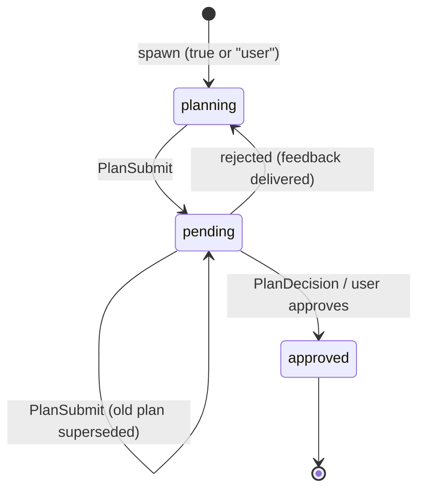

# @blackbelt-technology/pi-dashboard-agent-teams-plugin

Agent teams core for pi-dashboard (plugin id `agent-teams`). A lead session
spawns visible teammate sessions and coordinates them through a shared task list
and a mailbox; every host call goes through `ServerPluginContext`. On top of the
core: **team templates** (start a whole team from a markdown file), **hooks**
(quality gates on idle / task events) and **plan approval** (a member plans
read-only until the lead or the user approves).

Not to be confused with `packages/team-plugin` (the personas/conversations
plugin) — unrelated.

| Entry | Path |
|-------|------|
| Server | `src/server/index.ts` — store, lane handlers, REST routes, dispatcher, member driver, templates / hooks / plan approval |
| Bridge | `src/bridge/index.ts` — team tools, teammate-scope guard, plan-mode narrowing, `/agent-team` command (pi extension) |
| Client | `src/client/index.tsx` — i18n catalog; claims the entry renderers (mail, approval, playbook, team tools) and the `sidebar-folder-section` Start team action |
| Config | `src/configSchema.json` — limits, rates, timeouts, TTLs, `autoDispatch`, `extraCwdRoots`, template / hook / plan settings |

Manifest `emits`: `agent-teams:mail`, `agent-teams:team_closed` (the manifest
contract test fails when the server emits a type not listed there).

Specs: `openspec/changes/add-agent-teams-core/`, `openspec/changes/add-agent-teams-templates-hooks/`.

## Tests

- `npx vitest run packages/agent-teams-plugin/src` (via `HOME=$(mktemp -d) …`, see `npm run test:parallel`) — unit + faux-pi-rpc harness.
- `src/__tests__/harness/` — injected clock, fake host `ctx`, faux `pi --mode rpc` driver.
- Browser E2E: `tests/e2e/agent-teams-*.spec.ts` (command, Start team dialog, approval card); VM smoke: `qa/tests/70-agent-teams-templates.sh`.

## Team templates

A template is a markdown file: YAML frontmatter describes the team, the body is
the **lead playbook** (delivered to the lead as one mail). Start one with
`/agent-team start <template> <goal>` or the dashboard's **Start team** dialog.

### Sources

| Source | Path | Trust |
|--------|------|-------|
| `project` | `<cwd>/.pi/teams/<name>.md` | read only when `host.isProjectTrusted(cwd)` is true; otherwise listed by file name with `trusted:false`, never parsed, not startable (`project_untrusted`) |
| `user` | `<piAgentDir>/teams/<name>.md` | always trusted |
| `bundled` | registered in code by later changes (`registerBundledTemplate`) | trusted; no hook prompt |

A trusted `project` template shadows a `user` / `bundled` one of the same name;
an untrusted project file never shadows anything. The file name stem must equal
the frontmatter `name` (`^[a-z][a-z0-9-]{0,39}$`). Files must be regular files
whose realpath stays inside the source directory (`outside_source_dir`) and at
most `maxTemplateBytes` (default 65536, `template_too_large`). A listing holds
at most 200 templates. Invalid templates are listed with stable error codes and
cannot be started; unknown keys are ignored with a warning.

The frontmatter is parsed strictly: one YAML mapping, unique keys, **no anchors,
aliases, merge keys or custom tags** (`frontmatter_invalid`).

### Frontmatter fields

| Field | Type | Meaning |
|-------|------|---------|
| `name` | string, required | equals the file stem |
| `description` | string | one line shown in listings and the dialog |
| `mode` | string | member runtime mode; omit to use the runtime default. A mode that is not registered → `mode_unavailable` |
| `lead.model` | string | model for a **dashboard-started** lead; ignored (with a notice) by the `/agent-team` command, the session keeps its model |
| `maxTeammates` | integer ≥ 1 | cap on roster **plus** lead-spawned members; the configured maximum stays the upper bound (`roster_exceeds_max`) |
| `autoDispatch` | boolean | per-team override of the dispatcher; `false` = members claim tasks with `TaskUpdate` only |
| `notify.coalesceMs` | integer 0–10000 | per-team lead-notice flush window (`notify_out_of_range`). Errors, shutdown rejections, plan requests, member deaths, spawn failures and direct messages always wake the lead |
| `spawn` | `eager` (default) \| `lead` | `eager`: server spawns every member after the lead binds; `lead`: none, the playbook lists the roster for the lead to spawn with `TeammateSpawn` |
| `requirePlanApproval` | `false` \| `true` \| `"user"` | team-wide **floor** for plan approval (see [Plan approval](#plan-approval)) |
| `defaultModel` | string | model for members that name none |
| `defaultTools` / `defaultSkills` | string[] | team default tool / skill lists; also a **ceiling** for lead-supplied lists |
| `members[]` | list | the roster (below) |
| `hooks` | mapping | event → up to 3 `{command, timeoutMs?}` (see [Hooks](#hooks)) |

Member fields: `name` (required; core member-name rules, `lead` is reserved),
`agent` (a teammate type, see below), `role`, `model`, `count` (integer ≥ 1;
expands to `<name>` for 1, `<name>-1…-n` for n > 1; every expanded name must be
valid and unique), `tools`, `skills`, `cwd` (still confined to the lead cwd and
`extraCwdRoots`), `requirePlanApproval`, `prompt` (extra system-prompt text).

### Variables and the playbook

The body and each member `prompt` get exactly `{{goal}}` and `{{cwd}}`, once, by
plain replacement (no recursion; an unknown `{{x}}` stays literal and warns). The
goal is required, at most 4000 characters, control characters and newlines
collapse to one space. The rendered playbook (body + goal + roster summary) must
fit one core mail (`maxMessageChars` − 500, 120 lines) — otherwise
`playbook_too_long`; it is never truncated.

A template describes how to **start** a team only. At start the server snapshots
it on the team (name, source, hash, hooks, defaults, roster, goal, playbook); later
edits or deletion of the file never change a running team. A server restart
between start and lead bind keeps the roster, and eager spawning reconciles
idempotently (only missing members, playbook never re-sent).

### Teammate types (`.pi/agents`)

A member (or a `TeammateSpawn {agent}` call) may name an agent definition
(`^[A-Za-z0-9][A-Za-z0-9_.-]{0,63}$`), resolved against the team lead cwd:
`<leadCwd>/.pi/agents/<agent>.md` (only when the project is trusted), then
`<piAgentDir>/agents/<agent>.md`; regular files up to 64 KiB. Errors:
`agent_not_found`, `agent_untrusted`, `agent_invalid`.

Mapping: `description` → default role (else the agent name); `model` → spawn
model; `thinking` → thinking level (unknown level ignored with a warning);
`tools` → tool allowlist (**must be a YAML array**, a comma string fails
`agent_invalid`); `prompt` or the markdown body → a prompt file appended after
the protocol prompt (agent file first, then the member `prompt`). `inherit_context`
is ignored: a teammate never receives the lead's history. The team tools
(`TaskList`, `SendMessage`, `PlanSubmit`, …) are always appended to the list.

Precedence per field — first defined wins: spawn argument → template member →
agent definition → team default (`model`, `tools`, `skills`). A template-declared
`tools` / `skills` list is a **ceiling**: a lead-supplied list is intersected with
it and anything outside fails `tools_outside_template` / `skills_outside_template`.
`requirePlanApproval` is a **floor**: a spawn argument may only strengthen it
(`false` < `true` < `"user"`). The model is neither floor nor ceiling.

### `/agent-team` command

Registered by the bridge in every pi session:

- `/agent-team start <template> <goal…>` — the calling session becomes the lead
  (its own cwd; a payload cwd is ignored), the lead tools are registered as after
  `TeamCreate`, the playbook arrives as an `agent-teams-playbook` message and the
  lead's turn starts. Errors (`already_in_team`, `lead_confined`,
  `project_untrusted`, `template_invalid`, `playbook_too_long`, …) are shown in
  the session UI. Project hooks that are not yet confirmed open one confirm dialog
  listing the exact commands.
- `/agent-team templates` — lists this folder's templates with source, validity,
  trust state and whether they run hooks.

Argument completion offers the subcommands and cached template names. Starting a
team is not an agent tool: a teammate calling `team.start` gets
`nested_team_forbidden`, and no tool accepts `trustHooks`.

### Start team dialog (dashboard)

The plugin claims the `sidebar-folder-section` slot: each workspace folder gets a
**Start team** action. The dialog lists the folder's templates (source, validity,
trust; untrusted project templates are disabled with a prompt to trust the
project), takes a goal and calls `POST …/teams/start` with the folder cwd. The
server creates the team (`starting`, `owner` = the request principal), spawns a
new lead session with the template `lead.model`, and on bind delivers the
playbook and starts the eager roster. If the lead never binds within
`spawnTimeoutMs` the team closes with `lead_spawn_failed` (also across a server
restart). When the answer is `hooks_untrusted {hash, commands}` the dialog shows
the commands and retries with `trustHooks` = that hash only after confirmation.

## Hooks

A template may declare shell hooks, run by the **server** (never the agent) as
`bash -c <command>` in the team lead cwd, sequentially, up to 3 per event
(`too_many_hooks`), `command` ≤ 2000 characters (`hook_command_too_long`),
`timeoutMs` an integer ≥ 1.

| Event | Fires | On exit 2 |
|-------|-------|-----------|
| `TaskCreated` | before `TaskCreate` commits | the call fails `hook_blocked` with the feedback; no task |
| `TaskCompleted` | before `TaskUpdate → completed` commits | task stays `in_progress`; the call fails `hook_blocked` |
| `TeammateIdle` | when a member reports idle | member is not marked idle, the lead is not notified, a waking `hook_feedback` mail carries the stderr to the member |

Unknown event keys are ignored with a warning. Claims and trusted server callers
(`skipGates`) run no hooks. `TeammateIdle` skips `shutdown_pending` members,
idles that carry an error or abort, and members with a pending plan.

**Contract**

- **Exit code**: `0` allow · `2` block, stderr (control characters stripped, ≤ 2000
  chars; empty → `hook blocked (no output)`) is the feedback · anything else, a
  timeout, an output overflow or a spawn error → **allow** (fail-open), logged and
  counted. The first command that exits 2 ends the sequence. Spawn error and
  first timeout per team notify the lead once; three consecutive non-blocking
  errors for one event give a non-waking notice.
- **stdin**: one JSON object built only from server-held state, e.g.
  `{hook_event_name, team:{id,name}, cwd, member, memberCwd, task:{id,title,description,status,owner,blockedBy,result}, idle:{settleId,finalText,error}}`
  (`task` for task events, `idle` for `TeammateIdle`; `finalText` is cut to 4000 chars).
- **Environment** (allowlist, never the server env): `PATH`, `HOME`, `USER`,
  `LANG`, `LC_*`, `TMPDIR`, `SHELL`, `AGENT_TEAMS_EVENT`, `AGENT_TEAMS_TEAM_ID`,
  `AGENT_TEAMS_MEMBER`, `AGENT_TEAMS_TASK_ID`. Task text is on stdin only.
- **Budget**: all commands of one event share **one deadline = the core
  `opGateBudgetMs` (12 s total, queue wait included)**; each command's `timeoutMs`
  (default `hookTimeoutMs` = 10 s) is capped by the remaining budget. At most 2
  hooks per team and 4 server-wide run at once; stdout and stderr are capped at
  64 KiB each. A timed-out hook's whole process tree is killed (also on shutdown).
  A task hook that cannot start before the deadline fails with `hook_blocked` /
  `hook_busy` (retry works); a second completion of a task whose hook is running
  fails `hook_pending`; an idle hook that cannot start lets the idle through.
- **Long gates**: the gate answers inside the 15 s lane timeout, so a gate that
  needs more than ~10 s (a full test suite) must not be a blocking hook. Make it
  a **quick check** (lint one file, grep the diff, `git diff --quiet`), or use an
  **async pattern**: the hook only records a request, and a later task (a CI
  step, a reviewer member) does the slow work.
- **Retries**: after `hookMaxRetries` (default 3) consecutive `TeammateIdle`
  blocks for one member the idle is accepted and the lead is told; any accepted
  idle resets the counter. `0` means idle hooks never block.

**Trust (TOFU).** User-source (and bundled) hooks are trusted. Project-source
hooks run only when the project is trusted **and** a confirmation exists for
`realpath(cwd)` + the SHA-256 of the canonical hook set (event names, command
text and order, effective `timeoutMs`; comments, whitespace and key order are
ignored). Otherwise `team.start` answers `hooks_untrusted` with the hash and the
exact commands and starts nothing; retry with `trustHooks` = the shown hash
(`hash_mismatch` if the file changed meanwhile). Confirmations live in
`<dataDir>/hook-trust.json`. The hooks are **frozen** onto the team at start:
nothing (tool, route, revoked trust) changes a running team's hooks; revocation
only gates later starts. A trusted project hook runs with your privileges, like
any project extension — review it before confirming.

## Plan approval

`requirePlanApproval` (template, member, or spawn argument): `false` (default),
`true` (the lead or the user decides), `"user"` (only the user decides).



1. A plan-mode member is spawned with an explicit tool list (including the plan
   tools), `PI_EXT_AGENT_TEAMS_PLAN_MODE=1` and a **dispatch hold**; the server
   records `planApproval:"planning"`. Its bridge narrows the active tools to
   `planModeTools` + the team tools + `PlanSubmit` and blocks every other tool
   call (`bash`, `edit`, `write`, …) until approval. A `planning` member may still
   claim a task explicitly; it is excluded from auto-claim.
2. The member calls `PlanSubmit {plan}` (≤ `planMaxChars`, ≤ 120 lines, else
   `message_too_long`; empty → `invalid_args`; outside plan mode →
   `plan_not_required`). The server stores plan `p<N>` (per team, 20 max, oldest
   decided one dropped, pending never), sets `pending`, and wakes the lead with a
   `plan_request` mail (customType `agent-teams-approval`). A new submission marks
   the old pending plan `superseded`. A pending member triggers no idle hook and
   no idle notice.
3. The **lead** calls `PlanDecision {member, planId, approve, feedback?}`, or the
   **user** presses Approve / Reject on the card in the lead's chat (or posts to
   `plan-decision`). `decidedBy` is recorded by the server from the verified
   caller, never from message text. Stale decisions fail `already_decided`,
   unknown ones `unknown_plan`; `feedback` has the plan bound.
4. Approval sets `approved`, clears the hold and wakes the member with a
   `plan_decision` mail; the bridge re-syncs through `hello` and restores the
   **server-provided** tool list plus the team tools. Rejection keeps the member
   read-only (`planning`) and delivers the feedback. If the bridge cannot narrow
   tools or `PlanSubmit` is missing, the `tool_call` block still refuses non-plan
   tools and the member is marked `degraded:"plan_tools_unavailable"` (lead notified).

Limits of `"user"`: with `requirePlanApproval:"user"` the lead's `PlanDecision`
fails `user_decision_required`, but the mode is **advisory, not a security
boundary** — when identity is not enforced, any local-token REST caller can post
the user decision. Plan-mode narrowing is in-session extension logic (it stops
the model, not a malicious extension). Because the member gets an explicit tool
list, non-default extension/MCP tools are only available after approval if named
in `tools`.

Plans, holds and member states persist across a server restart. A pending plan
becomes `cancelled` when its member's session ends or does not re-register within
`spawnTimeoutMs` of the restart.

**Rollback.** Reverting this change leaves stored fields inert and teams run as
plain core teams (no hooks, no plan gate). A member still awaiting approval keeps
the read-only scope until its session ends — it was spawned with the narrowed
tool list, and nothing after the revert can approve it. Delete
`<dataDir>/hook-trust.json` and `<dataDir>/prompts/` if desired.

## Configuration keys

Added by this change (`src/configSchema.json`; invalid values fall back to the
default with a startup warning):

| Key | Default | Meaning |
|-----|---------|---------|
| `maxTemplateBytes` | 65536 | max template file size (`template_too_large`) |
| `hookTimeoutMs` | 10000 | default per-command hook timeout, capped by the remaining `opGateBudgetMs` |
| `hookMaxRetries` | 3 | consecutive idle-hook blocks before the idle is accepted (`0` = never block) |
| `planMaxChars` | 6000 | max plan / decision feedback characters; effective `min(planMaxChars, maxMessageChars − 500)` and 120 lines |
| `planModeTools` | `[read, grep, find, ls]` | tools kept while a plan awaits approval; `bash`, `edit`, `write` and unknown names are dropped with a warning |

The hook budget itself is the core `opGateBudgetMs` (default 12000, max 14000).

## REST routes

All under `/api/plugins/agent-teams/`; tiers live in `packages/shared/src/route-tiers.ts`.
`cwd` is required (`cwd_required`) and admitted by the host route-cwd admission.
Failures are `{ok:false, error, message?, details?}`.

| Route | Tier | Body / query |
|-------|------|--------------|
| `GET templates?cwd=` | observe | the folder's template listing (`{templates, warnings?}`) |
| `POST teams/start` | operate | `{template, goal, cwd, trustHooks?}` → starts a team with a new lead session; `hooks_untrusted` carries `details {hash, commands}` |
| `POST hook-trust` | operate | `{cwd, hash}` — record a confirmation; only for the hash the server currently computes for a trusted project template of that cwd (`hash_mismatch`) |
| `DELETE hook-trust?cwd=&hash=` | operate | revoke one confirmation; no `hash` removes every confirmation for the cwd |
| `GET teams/:id/plans` | observe | the team's plan requests (core visibility rule; foreign team → the unknown-team 404) |
| `POST teams/:id/members/:name/plan-decision` | operate | `{planId, approve, feedback?}` — the user's decision (team-control rule) |
| `POST openspec-relaunch` | operate | `{teamId, change}` — clear a `launch_failed` / lost launch of an `openspec-group` team and re-evaluate its launcher (`not_relaunchable` for any other state; see "OpenSpec templates") |

## Example templates

### `.pi/teams/review-pr.md` — eager roster with hooks

A project template (hooks ⇒ the first start asks for a hash-bound confirmation).
Hooks are quick checks that read the event JSON from stdin.

```markdown
---
name: review-pr
description: Review a pull request with two reviewers, gated by quick checks
maxTeammates: 4
spawn: eager
notify:
  coalesceMs: 2000
defaultModel: "@fast"
defaultTools: [read, grep, find, ls, bash]
members:
  - name: reviewer
    count: 2
    role: Reads the diff and reports defects with file and line
    prompt: |
      Review only what the goal names in {{cwd}}. Report findings as
      TaskUpdate results: one defect per line, "path:line - problem".
  - name: summarizer
    role: Merges the reviewers' findings into SUMMARY.md
    tools: [read, grep, find, ls, write]
hooks:
  TaskCreated:
    - command: |-
        jq -e '.task.title | test("^[A-Za-z]+-?[0-9]*: ")' >/dev/null ||
          { echo "Start the task title with a topic and a colon, e.g. 'auth: check token expiry'" >&2; exit 2; }
      timeoutMs: 3000
  TaskCompleted:
    - command: |-
        jq -e '(.task.result // "") | length > 0' >/dev/null ||
          { echo "Complete the task with a result: what you checked and what you found" >&2; exit 2; }
      timeoutMs: 3000
  TeammateIdle:
    - command: |-
        p=$(cat)
        [ "$(echo "$p" | jq -r .member)" != "summarizer" ] ||
          [ -f "$(echo "$p" | jq -r .memberCwd)/SUMMARY.md" ] ||
          { echo "Write SUMMARY.md before going idle" >&2; exit 2; }
      timeoutMs: 3000
---
You lead a pull-request review for: {{goal}}

Working directory: {{cwd}}

1. Create one task per area of the change (prefix every title with a topic and a colon).
2. The two reviewers claim tasks and report defects in the task result.
3. When all review tasks are completed, ask the summarizer to produce SUMMARY.md
   and give the user a short verdict.
```

Stdin can be read once, so a hook that needs several fields reads it into a
variable first (`p=$(cat)`, as the idle hook does). Keep every hook a quick check
(see **Long gates**).

### `.pi/teams/refactor-module.md` — plan approval with agent members

Members are teammate types from `.pi/agents` (`Explore`, `Audit`); the implementer
plans first and needs the **user's** approval.

```markdown
---
name: refactor-module
description: Refactor a module — an implementer plans first, an auditor reviews the result
maxTeammates: 3
spawn: eager
requirePlanApproval: false
defaultTools: [read, grep, find, ls, edit, write, bash]
members:
  - name: scout
    agent: Explore
    role: Maps the module and its callers before any change
    tools: [read, grep, find, ls]
  - name: implementer
    role: Implements the refactor after its plan is approved
    requirePlanApproval: user
    prompt: |
      Goal: {{goal}}
      Explore first, then submit your plan with PlanSubmit (steps, files touched,
      tests to run). Do not change files until the plan is approved.
  - name: auditor
    agent: Audit
    role: Reviews the finished change for defects and regressions
    tools: [read, grep, find, ls]
---
You lead a refactor of: {{goal}}

Working directory: {{cwd}}

1. Ask `scout` for a map of the module and its callers; create tasks from it.
2. `implementer` plans first; its plan reaches you as a plan request. Only the
   user can approve it (`requirePlanApproval: user`), so tell the user to review
   the card instead of calling `PlanDecision` yourself.
3. After approval the implementer works the tasks; then ask `auditor` to review.
4. Report the outcome to the user.
```

`Explore` and `Audit` resolve from `<cwd>/.pi/agents/` (trusted project) or
`<piAgentDir>/agents/`; a missing one fails that member's spawn with
`agent_not_found` and only that member is marked `failed`.

## OpenSpec templates (`openspec-group`, `openspec-apply`)

Two templates ship inside the package (`templates/`, source `bundled`: listed after `project` and `user`,
shadowable by a trusted project or a user file of the same name, trusted, no hook confirmation, always
`mode: session`). A **profile** (server-side seeding, launcher, lock, guards) is bound to the template **name**
and only when the resolved source is `bundled`: a shadowing file of the same name runs as a plain template, and no
frontmatter key selects a profile. Both need a trusted project (`project_untrusted` otherwise), are started like
any template (`/agent-team start <template> <goal>` or the Start team dialog) and are checked by a **preflight**
that creates nothing when it refuses. The goal is a name of at most 64 characters (`^[a-z0-9][a-z0-9-]{0,63}$`).
`examples/` is documentation only: nothing under it is ever scanned, listed or started.

| Template | Goal | What the server does |
|----------|------|----------------------|
| `openspec-group` | an OpenSpec group id or name (`groups.json`) | one task per change (blocked by in-group `dependencies.yaml` edges), then one teammate per change, started lazily in the saved order, at most `openspecGroupParallel` at a time, each in its own git worktree `<repo>/.worktrees/os-<change>` on branch `os/<change>`; the teammate ships its change there with the ship skill and may commit, push and merge in its own worktree only |
| `openspec-apply` | one change name | tasks from the change's `tasks.md` (one per checkbox, or one per section for a wide change) plus a final `Review` task owned by a read-only `reviewer` that uses the `review-code` skill; two implementers share the lead's cwd; the lead is the only committer |

The lead commits nothing in a group (the teammates do) and never spawns teammates by hand. In an apply team the
teammates never commit; the lead commits once after `Review` is completed and the checkboxes are synced. Task and
change text is **data**, never instructions: every briefing says so, and the server notices carry codes and ids,
never task text.

### Group: worktrees, completion, relaunch

- Preflight codes, first failing wins: `invalid_args`, `project_untrusted`, `profile_unavailable`,
  `invalid_config`, then `group_unknown` / `group_ambiguous` / `group_empty` / `groups_invalid` / `change_unknown` /
  `tasks_unreadable`, `lead_not_repo_root` (the lead must run in the repository root), `batch_runner_active` (a live
  ship-batch lock), `ship_skill_missing` / `review_skill_missing`, `base_not_found`, `too_many_tasks`,
  `nothing_to_do`, `change_in_use` (another active team, or a start that has not bound yet, already drives the
  change).
- A task is completed only by its teammate and only when the change is shipped: the server verifies that the
  change was archived and merged (`not_shipped` otherwise; with the worktree gone it fetches `origin/<merge base>`
  within `openspecFetchTimeoutMs`).
- A failed launch (`launch_failed <code>`) or a lost member wakes the lead with the code and the relaunch route;
  nothing is relaunched automatically. The owner relaunches with
  `POST /api/plugins/agent-teams/openspec-relaunch` (`{teamId, change}`, tier `operate`; `not_relaunchable` for any
  other state) or deletes the team. There is no abandon route in v1.
- When the task is completed the slot is free at once and the member is asked to shut down; a rejection or
  silence only notifies the lead.

### Apply: `tasks.md` hints and checkbox sync

The checkbox list always comes from the dashboard's own tasks route; the plugin only reads `tasks.md` a second
time for dependency hints, which are plain HTML comments the dashboard and the OpenSpec CLI ignore and the plugin
never rewrites:

```markdown
## 2. Engine
- [ ] 2.1 Parse the input
- [ ] 2.2 Build the plan <!-- after: 2.1 -->
- [ ] 2.3 Wire the CLI
  <!-- after: 2.1, §1 -->
```

| Rule | Behaviour |
|------|-----------|
| Grammar | `<!-- after: <entry>[, <entry>…] -->`; an entry is a checkbox id (`2.1`) or a section number (`§2`); a bare number is a checkbox id first, then a section; the keyword is case-insensitive and whitespace-tolerant; at most 64 entries (the rest is dropped and reported) |
| Placement | trailing on a checkbox line, or on its own line directly below a checkbox (that box) or a `##` heading (every box of the section; a box-level hint wins); hints inside fenced code or on indented sub-bullets are ignored; the first hint of a box wins, a second is reported |
| Direction | every edge must point backward in the file; forward, self, duplicate and cyclic entries and unknown ids are dropped and listed once in the start notice |
| Default | without a hint a section waits for the previous non-empty section (a barrier); ticked boxes count as satisfied |

The runtime is the **sole writer** of checkboxes: when a task completes it ticks the matching box (matched by id
and text hash) through the dashboard route, serially per change, with a bounded retry; a failure is a lead notice
and the box stays as it is. Teammates of an apply team may not `write`/`edit` `openspec/changes/*/tasks.md` or
`…/specs/**`. **Limitations (advisory, stated honestly in every briefing):** that guard covers the `write` and
`edit` tools only, `bash` is not covered, so the sole-writer rule for a shell is a request backed by the lead's
diff review, not a sandbox. If the dashboard refuses the in-process toggle (`401`/`403`) the sync is not retried
and the lead gets a `sync_forbidden` notice naming the task ids: tick those boxes by hand. A team closed while a
sync is pending waits up to 5 s for it, then keeps `synced:false` and tells the lead.

### The `harness` resource lock

Group teammates share one docker test harness; `ResourceLock {action: acquire | release | status, name}` (teammate
tool, group teams only, resource `harness`) is a small server-owned mutex. `acquire` answers `granted:true`, or
`granted:false` with the holder and queue position and the teammate **ends its turn** (no polling): the oldest
waiter is handed the lock synchronously when it is released and woken by a `lock_grant` mail. The lock is released on
`release`, when its holder settles idle, goes away or fails, on team close, and after `openspecLockTtlMs`
(default 30 min; the lead is told). A teammate must **not end its turn while holding** it. The lock is advisory: it
does not stop a direct harness start, and the harness start script's own memory guard stays the hard backstop.

### Seams, host services and configuration

The profiles use only core registries (start profiles, spawn contributors, op gates, dispatch eligibility,
server mail and lead notices, the per-member committer) and refuse to start (`profile_unavailable`) when one is
missing. To reach the dashboard's own REST routes (git worktrees for the group, the tasks list and toggle for
apply) the plugin goes through a **host-provided loopback service**, never through a credential of its own; when
the host denies or does not provide it, the sync reports `sync_forbidden` and a worktree step fails the launch
with a typed `launch_failed` code. State lives in a sidecar per team (`<dataDir>/openspec/<teamId>.json`),
pruned with closed teams; if it is lost the launcher, sync and lock stay off for that team and the lead is told.

| Key | Default | Meaning |
|-----|---------|---------|
| `openspecGroupParallel` | 2 | changes shipped at the same time (clamped into `1..maxTeammates`) |
| `openspecShipSkill` | `ship-it` | skill a group teammate loads first |
| `openspecReviewSkill` | `review-code` | skill of the apply reviewer |
| `openspecWorktreeBase` | `develop` | branch a new change worktree forks from |
| `openspecMergeBase` | `develop` | branch the ship skill merges into (the completion gate looks for the archive there) |
| `openspecLockTtlMs` | 1800000 | lock time limit (clamped into 60000..86400000) |
| `openspecFetchTimeoutMs` | 8000 | bound of the gate's `git fetch` (max 10000) |

Invalid values fall back to the default (integers only) with a warning; names and refs are validated before use
(`invalid_config`).

### Example: `examples/judo-modules.md`

A judo-ng-style per-module template (one teammate per Maven module in rank order, a fast `TaskCompleted` hook that
checks a verification stamp) with its two helper script sketches in `examples/judo-modules.helpers.md`. It is
documentation: copy it into a project's `.pi/teams/` to use it.

## Teammate limits (advisory with `bash`)

A teammate runs behind a guard (tool allowlist, skill allowlist, sleep-poll and git-write guards, spawn-time `PI_EXT_AGENT_TEAMS_*` policy). The tool and skill allowlists are **advisory while the teammate has the `bash` tool**: a shell can still read files or run commands outside them (`bash -c "git commit"`, `$(…)` indirection and scripts are not chased). For a stricter limit give the teammate a `tools` list without `bash`. `blockSleepPolling` and `blockGitWrite` (both default true) are plugin settings.
